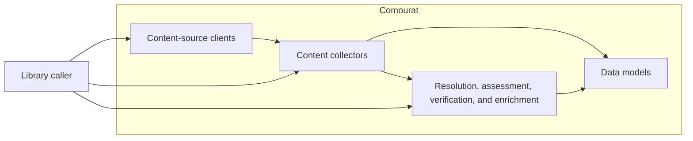

## Comourat constitution spec

### 1. Executive summary

#### 1.1. Project description

Comourat is a reusable Python library for collecting and processing research-related content. It provides data models and components for collection, resolution, influence assessment, and web-content enrichment. Callers provide configuration through constructor arguments.

#### 1.2. Project motivation

Comourat provides reusable collection and content-processing components for Python projects. Its standalone repository defines the library’s package and test boundary.

#### 1.3. Implementation repos

- `anton-pershin/comourat`

#### 1.4. Architecture type

Modular monolith. Comourat groups components by function, such as clients, collectors, influence, enrichment, resolution, and verification. Components expose direct Python interfaces.

#### 1.5. Execution mode

Manual.

### 2. Requirement analysis

#### 2.1. Functional requirements

**FR1 — Content-source access.** Comourat provides reusable components to access research-related content from external sources. These components support retrieval and navigation operations that each source makes available.

**FR2 — Content collection.** Comourat provides components to collect research-related content from external sources, including content found through search, feeds, or links between items.

**FR3 — Content processing.** Comourat provides components to resolve, assess, verify, or enrich collected content where these operations support the library’s purpose.

#### 2.2. Non-functional requirements

**NFR1 — Standalone use.** Comourat operates as a standalone Python library. It does not depend on an application-specific pipeline framework, monitoring system, database, output writer, or configuration framework.

**NFR2 — Explicit configuration.** Callers provide configuration through component interfaces. Components do not read environment variables or configuration files implicitly.

#### 2.3. Preferences

**P1 — Data models.** Use Pydantic models for structured data exchanged by library components. Keep application-specific context and relevance scores outside the library’s neutral models.

**P2 — Public interfaces.** Keep public interfaces small and document them.

**P3 — Component boundaries.** Group components by function and support their reuse without a pipeline framework.

### 3. Acceptance criteria

Automated tests verify the functional and non-functional requirements. Tests use mocked external services and controlled inputs. They verify that:

- Content-source components support the operations that their interfaces expose.
- Collection components produce the documented content models from valid source responses.
- Processing components produce the documented results for valid inputs and handle documented failure cases.
- The library runs without application-specific framework, monitoring, database, writer, or configuration-framework dependencies.
- Components use caller-provided configuration and do not read environment variables or configuration files implicitly.
- Tests do not require live network access.

### 4. Insight

no need for the insights

### 5. Overall solution design

#### 5.1. High-level design

#### 5.2. Core components

Comourat’s primary components are content-source clients, collectors, processing components, and shared data models. A library caller configures and invokes these components through their Python interfaces.
