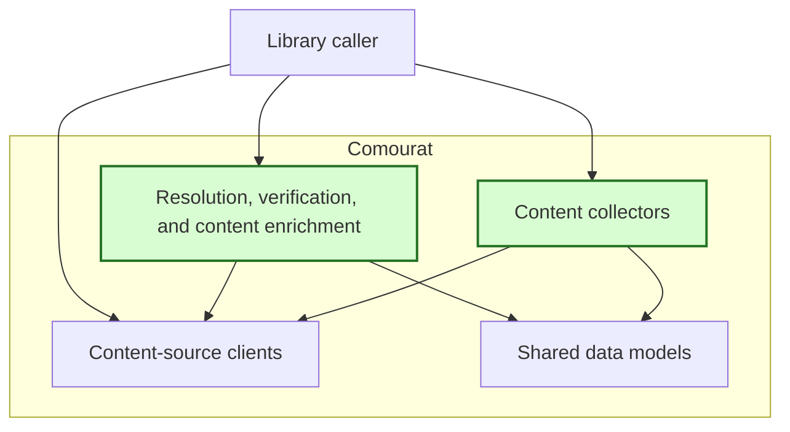
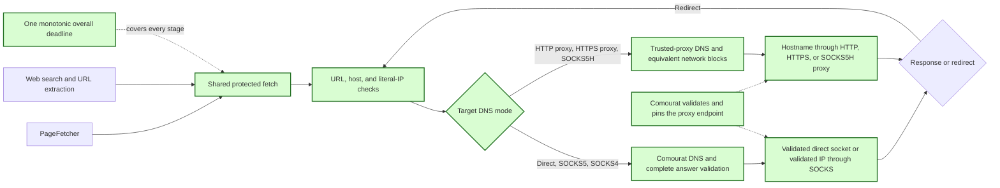

## Safe collection and enrichment fetch policies

### 1. Executive summary

#### 1.1 Spec description

This spec defines shared controls for PageFetcher article fetches and every web-search and URL-extraction request used by collection and enrichment agents. For direct requests and proxy modes with Comourat DNS, the controls validate each URL, redirect, and complete DNS answer set and bind a validated address to the actual connection. For requests that use trusted-proxy DNS, the proxy and its network rules apply the same destination policy because Comourat cannot see the remote DNS answer. One overall time limit includes DNS resolution, connection setup, response transfer, redirects, and retries.

#### 1.2 Spec motivation

Vesna, a Comourat consumer application, fetches untrusted URLs from machines that can access private-network services. The current Requests calls have no common target policy and can follow redirects or use proxy-side DNS resolution to reach prohibited services. Vesna needs these controls in Comourat so that it does not need a separate fetcher.

#### 1.3 Implementation repos

- `anton-pershin/comourat`: management repository and implementation repository.

### 2. Requirement analysis

#### 2.1 Functional requirements

**FR1 — Covered paths and dependency injection.** Provide one shared protected fetch capability for PageFetcher article fetches, the `extract_url` tool, and the `web_search` tool. Cover the agents created by `create_enrichment_agent`, `EnrichmentAgent`, and `PaperDiscovererCore`. Let callers inject the fetch policy and HTTP session through the public interfaces of these components. Apply the protected default policy when the caller does not inject one. An injected session must use the same policy and must not disable validation.

**FR2 — URL and destination rules.** Permit only valid HTTP and HTTPS target URLs. Reject other schemes, missing hosts, and invalid ports before DNS resolution or connection. Reject non-global and multicast IPv4 and IPv6 target addresses, including loopback, private, link-local, unspecified, reserved, and carrier-grade NAT addresses. Check IPv4-mapped IPv6 addresses against the rules for both address families. Let callers add exact-host, IP-address, and CIDR deny rules for targets such as the home-server TTS endpoint. Match host rules after case, IDNA, and trailing-dot normalization. Apply IP-address and CIDR rules to literal addresses in Comourat and to resolved addresses in the component that performs DNS resolution.

**FR3 — Complete DNS-answer validation.** For each target resolved by Comourat, resolve all available IPv4 and IPv6 addresses before opening a network connection for that target. Reject an empty answer set. If any answer is prohibited or matches a caller deny rule, reject the complete target instead of selecting another answer. Apply the same rule to every later resolution of the target. Never reuse a previous approval for a new DNS answer set. When a trusted proxy resolves the target, apply FR5 instead.

**FR4 — Direct connection binding.** For a direct request, create the socket from the validated DNS answers without a second hostname resolution. The address passed to the socket connect operation must be one of the validated addresses. A failure to connect to one allowed address may try another allowed address from the same validated answer set.

**FR5 — Trusted-proxy DNS and connection binding.** Support explicitly configured HTTP, HTTPS, SOCKS4, SOCKS5, and `socks5h` proxies. Treat the caller-hosted proxy as trusted infrastructure and permit its explicit loopback or private address. Apply caller deny rules to the proxy endpoint as well as to targets. Resolve and pin the address used for the actual proxy socket. For an HTTP-forward or HTTP CONNECT request with a target hostname, send the hostname to the proxy without local target DNS resolution. For `socks5h`, send the target hostname with remote DNS enabled. For SOCKS5 and SOCKS4, use the complete Comourat DNS validation from FR3 and send a validated IP address to the proxy. Support SOCKS4 only for IPv4 targets and reject SOCKS4 IPv6 targets before connection. Preserve the original host in the HTTP `Host` header, TLS SNI, and certificate verification. When a proxy performs target DNS resolution, the caller must configure the proxy and its network to enforce the same default destination rules and caller IP-address and CIDR deny rules on every request. Comourat cannot inspect the remote DNS answer and must document this division of responsibility. Do not let a redirect or target URL select a proxy.

**FR6 — Redirect validation.** Apply URL and local deny-rule validation to every redirect target. Apply FR3 to targets resolved by Comourat and FR5 to targets resolved by a trusted proxy. Reject a locally prohibited redirect before opening a proxy or target connection for it. A proxy that applies FR5 must reject its prohibited redirect destination before connecting to that destination. Include all redirects in the same overall operation and time limit.

**FR7 — Overall deadline and retries.** Use one monotonic deadline for each top-level page fetch or web-tool request. Include local and proxy-side target DNS resolution, proxy-endpoint DNS resolution, direct and proxy connection setup, proxy negotiation, TLS handshakes, request-body transfer, response headers, response-body transfer, redirects, retries, and retry delays. Each stage must use only the remaining time. A late local DNS result must not start a connection after the deadline. Provide a configurable overall timeout with a default of 30 seconds. Provide configurable finite limits for redirects and retries, with automatic retries disabled by default.

**FR8 — Failure behavior and fallback prevention.** The shared fetch interface must report local target-policy failures and overall-deadline failures to its caller. A proxy-enforced denial may surface as a proxy or HTTP failure. A locally denied target must fail before any proxy or target connection for that request. A proxy-enforced denial must not reach the denied destination. A failure must not cause a retry through an unprotected direct or proxy path. This spec does not change the article-extraction or enrichment result models, and it does not add URL-policy controls to unrelated API clients.

#### 2.2 Non-functional requirements

**NFR1 — Explicit configuration.** Read no policy, proxy, credential, or timeout configuration from environment variables or configuration files. Disable environment-proxy discovery on protected sessions. Accept only caller-provided policy, session, proxy, and resolver configuration.

**NFR2 — Isolation and concurrency.** Do not change process-global DNS, socket, Requests, or urllib3 behavior. Isolate policy and deadline state between clients and between concurrent requests. One client must not weaken or change another client's policy.

**NFR3 — Deterministic verification.** Test protected paths with controlled listeners, recording proxies, injected resolvers, and controlled clocks or events. Tests must not require public-network access, external services, credentials, or the real home-server TTS endpoint. Deadline tests must be fast and must not depend on long sleeps.

**NFR4 — Security and resource handling.** Do not expose proxy credentials, authentication responses, private content, or generation endpoints in logs, exceptions, test output, or fixtures. Close sockets and responses after failures, redirects, and timeouts. A late resolver completion must not create a socket.

**NFR5 — Minimal and compatible implementation.** Keep the public interfaces small and consistent with existing constructor-injection patterns. Use the existing Python 3.12, Requests, urllib3, and PySocks dependencies without a new runtime dependency. Preserve existing behavior outside the covered paths.

**NFR6 — Documentation.** Document the default destination rules, caller deny rules, dependency injection, trusted-proxy model, proxy-protocol limits, and disabled environment proxies. State which protocols use Comourat DNS or trusted-proxy DNS. Explain that the caller must configure equivalent resolved-address and CIDR blocks on a proxy that performs DNS resolution. Document redirect and retry defaults and all stages included in the overall deadline.

### 3. Acceptance criteria

**AC1 — Covered interfaces and explicit injection.** Covers FR1, NFR1, and NFR5.

- Tests show that PageFetcher, `extract_url`, and `web_search` use the shared protected fetch capability. Tests cover the wiring through `create_enrichment_agent`, `EnrichmentAgent`, and `PaperDiscovererCore`.
- Tests inject a policy, session, proxy, and resolver through public interfaces and show that each component uses them. An injected real HTTP session cannot bypass the policy.
- Tests show that the default policy is protected and that environment variables and configuration files do not change policy, proxy, credential, resolver, or timeout configuration.
- Existing tests for unrelated clients and result models pass without new URL-policy behavior.

**AC2 — URL and destination policy.** Covers FR2 and FR8.

- Parameterized tests accept valid HTTP and HTTPS targets and reject unsupported schemes, missing hosts, and invalid ports before DNS resolution or socket creation.
- Parameterized tests reject loopback, private, link-local, unspecified, multicast, reserved, carrier-grade NAT, and other non-global IPv4 and IPv6 literals. Include IPv4-mapped IPv6 forms and alternative textual IP forms that resolve to prohibited addresses.
- Tests verify case, IDNA, and trailing-dot normalization for exact-host deny rules. Tests verify IP-address and CIDR deny rules for literals and resolved addresses, including a representative home-server TTS endpoint that is not a real service.
- Each Comourat rejection has a clear policy-failure result and creates no target or proxy connection. Tests apply resolved-address rules through Comourat for local DNS and through a controlled policy-enforcing proxy for delegated DNS.

**AC3 — DNS answers and direct connection binding.** Covers FR3, FR4, and NFR3.

- Tests reject empty DNS answer sets and every mixed answer set that contains a prohibited or caller-denied address. Test both orders of allowed and prohibited answers and prove that no allowed answer is selected silently.
- A recording socket proves that the address used by the real connect operation belongs to the validated answer set and that no second hostname resolution occurs. A test proves that a second allowed address from the same set can be tried after a connection failure.
- A changing-resolution test returns an allowed answer for a control request and a prohibited answer for a later request. The control request succeeds, the later request fails, and the prohibited listener records zero connections and zero requests.
- Allowed control requests use the real transport code. A narrowly scoped test policy may permit only the control listener; all prohibited-target assertions use the production destination rules.

**AC4 — Trusted-proxy DNS and binding.** Covers FR5, NFR1, NFR3, and NFR4.

- Recording HTTP-forward, HTTP CONNECT, HTTPS-proxy, SOCKS4, SOCKS5, and `socks5h` fixtures verify the actual proxy connection and requested target. Allowed control requests prove that each supported path works.
- Tests prove that the proxy socket uses a validated proxy address. Explicit loopback and private proxy endpoints work, while a proxy endpoint that matches a caller deny rule is rejected before connection.
- HTTP-forward tests verify a target hostname in the request URI and the original host in `Host`, with no local target DNS call. CONNECT tests verify a target hostname in the tunnel request and the original host in TLS SNI and certificate verification. HTTPS-proxy tests also verify the proxy TLS identity.
- SOCKS5 tests verify Comourat DNS validation and an IP-address target. `socks5h` tests verify a hostname target, remote DNS, and no local target DNS call. SOCKS4 IPv4 tests verify an IP-address target, and SOCKS4 IPv6 tests reject the target before connection.
- A controlled policy-enforcing proxy applies the same default and caller deny rules as Comourat. Tests prove that it rejects prohibited and caller-denied DNS answers, mixed answer sets, and changed answer sets before connection to the destination. These assertions are identified as proxy-enforced checks, not Comourat DNS checks.
- A locally prohibited target creates no proxy or target connection. A proxy-enforced denial reaches no prohibited target. Environment proxies are ignored, redirect data cannot select a proxy, and logs and errors contain no proxy credentials.

**AC5 — Redirect and entry-point security matrix.** Covers FR1, FR3, FR5, FR6, and NFR3.

- For PageFetcher, `extract_url`, and `web_search`, controlled tests independently cover a direct prohibited target, an allowed URL that redirects to a prohibited target, and a resolution change from an allowed answer to a prohibited answer.
- Repeat direct and redirect rejection through representative direct, HTTP-proxy, SOCKS5, and `socks5h` configurations. Include unsupported-scheme redirects, caller-denied redirects, mixed-answer redirects, and IPv4 and IPv6 cases. Exercise both Comourat DNS and controlled policy-enforcing proxy DNS as applicable.
- Each prohibited listener records zero accepted connections and zero HTTP requests. An allowed direct control and an allowed redirect control succeed through each test path to prove that the fixtures, proxy rules, and transport still work.
- Redirect-limit tests fail before another connection. All redirect attempts use the same policy and overall operation.

**AC6 — Overall deadline and retries.** Covers FR7, FR8, and NFR3.

- Controlled tests cover local target DNS, proxy-side target DNS, proxy-endpoint DNS, direct connection, proxy connection, proxy negotiation, proxy and target TLS handshakes, request-body transfer, response headers, response-body transfer, redirects, retries, and retry delays.
- Tests prove that each stage receives the remaining time rather than a new full timeout. A trickled response-body test proves that per-read progress does not reset the overall deadline.
- Tests prove that a late local resolver result creates no socket and that no stage starts after the deadline. A redirect or retry cannot extend the operation deadline.
- Tests verify the 30-second default, caller configuration, finite redirect and retry limits, and disabled automatic retries by default. Deadline tests complete quickly with controlled clocks or events.

**AC7 — Failure isolation and resource cleanup.** Covers FR8, NFR2, and NFR4.

- Tests distinguish Comourat policy failures from overall-deadline failures at the shared fetch interface. Tests also verify the documented proxy or HTTP failure behavior for proxy-enforced denials. No failure selects an unprotected direct or proxy fallback.
- Concurrent tests use clients with different policies, resolvers, proxies, and deadlines and show no shared-state interference. Static checks show no process-global DNS or socket replacement and no environment lookups.
- Failure, redirect, and timeout tests show that responses and sockets are closed. Log and exception tests show no proxy credentials, authentication responses, private content, or generation endpoints.

**AC8 — Documentation and regression verification.** Covers NFR5 and NFR6.

- Documentation describes policy and session injection, default prohibited destinations, host/IP/CIDR deny rules, the trusted self-hosted proxy model, supported proxy protocols, SOCKS4 IPv6 limits, disabled environment proxies, and the overall deadline.
- Documentation identifies the protocols that use Comourat DNS or trusted-proxy DNS. It instructs the caller to configure equivalent resolved-address and CIDR blocks on a proxy that performs DNS resolution and states that Comourat cannot inspect the remote answer.
- Documentation states the default timeout, redirect and retry limits, disabled automatic retries, and every stage included in the deadline.
- No new runtime dependency is added. All new acceptance tests and the complete existing test suite pass in the project Python environment.

### 5. Overall solution design

#### 5.1 High-level design

The first diagram copies the constitution design and marks the changed components in green.

The second diagram shows the shared protected fetch component and the two DNS responsibilities.

Comourat enforces local checks and every DNS answer that it resolves. A trusted proxy that performs target DNS resolution must enforce the same resolved-address and CIDR rules. Every direct response, proxy response, redirect, and retry remains within the same overall deadline.
