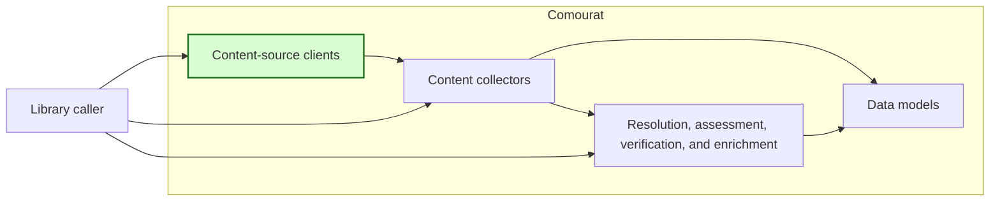
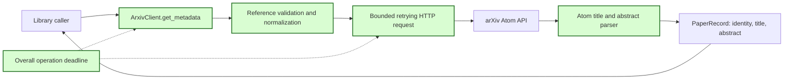

## arXiv title and abstract retrieval

### 1. Requirement analysis

**R1 — Public retrieval interface.** Add `ArxivClient.get_metadata(reference: str) -> PaperRecord | None`. Return a paper record with `identity.arxiv_id`, `title`, and `abstract` populated. Keep all unrelated paper-record fields at their defaults. Use only the arXiv Atom API. Do not request or extract the paper body. Keep `get_title_by_id` and `search_by_title` compatible.

**R2 — Accepted references.** Accept a bare arXiv identifier, an arXiv abstract URL, or an arXiv PDF URL. Support current identifiers such as `1706.03762` and legacy identifiers such as `hep-th/9901001`. Accept an optional `arXiv:` prefix and version suffix for identifiers. Accept HTTP and HTTPS URLs on `arxiv.org` or `www.arxiv.org`, with `/abs/` or `/pdf/` paths and an optional `.pdf` suffix. Remove surrounding whitespace and ignore URL query and fragment components. Normalize the returned arXiv identifier through the existing paper-identity rules.

**R3 — Source response handling.** Read the title and abstract from the first Atom entry. Collapse whitespace in both fields as the existing title lookup does. Return `None` when the feed has no entries because this is how arXiv reports an unknown paper. Reject a feed entry without a non-empty title or abstract. Reject malformed Atom XML. Do not return a partial paper record.

**R4 — Explicit failures.** Raise `ValueError` for an empty, malformed, or unsupported reference before any source request. Raise `ArxivMetadataError` for malformed XML or incomplete metadata. After the configured retries, propagate provider HTTP failures as `requests.HTTPError`, connection failures as `requests.ConnectionError`, and request timeouts as `requests.Timeout`. Do not convert these failures into an empty or successful result.

**R5 — Operation time limits.** Preserve `timeout_seconds` as the connection and read timeout for each HTTP request, with its current 120-second default. Add `overall_timeout_seconds` with a 120-second default. Apply one monotonic overall time limit to the complete operation, including HTTP requests, response parsing, retries, backoff, and politeness delays. Pass only the remaining time to each HTTP request and delay. Raise `requests.Timeout` when the overall limit expires. Validate both timeout values as positive finite numbers.

**R6 — Documentation.** Document the new public interface, accepted reference forms, `None` result, exceptions, absence of paper-body extraction, and both timeout settings in the README. Include a small usage example.

Expected behavior variants:

- **B1 — Bare current identifier.** `1706.03762` returns the expected title and abstract.
- **B2 — Prefixed and versioned identifier.** `arXiv:1706.03762v2` retrieves the same normalized paper identity.
- **B3 — Legacy identifier.** `hep-th/9901001v1` is accepted and normalized without treating the archive prefix as a URL path.
- **B4 — Abstract URL.** HTTP and HTTPS abstract URLs, with or without a version suffix, return the same paper record as the bare identifier.
- **B5 — PDF URL.** PDF URLs, with or without `.pdf` and a version suffix, use the Atom API and return no paper-body content.
- **B6 — URL components.** Surrounding whitespace, URL query strings, and fragments do not change identifier extraction.
- **B7 — Unknown paper.** A valid identifier whose Atom feed has no entries returns `None`.
- **B8 — Invalid references.** Empty strings, malformed identifiers, unsupported schemes, non-arXiv hosts, and unrelated arXiv paths raise `ValueError` without an HTTP request.
- **B9 — Incomplete or malformed responses.** Missing or blank title or abstract fields and malformed XML raise `ArxivMetadataError`.
- **B10 — Provider and transport failures.** Exhausted HTTP, connection, and request-timeout failures retain their documented Requests exception types.
- **B11 — Overall timeout.** Retry, backoff, and delay sequences cannot exceed the configured overall time limit; expiry raises `requests.Timeout`.
- **B12 — Existing behavior.** Existing title lookup, title search, proxy validation, and unrelated client behavior remain compatible.

### 2. Tests

Add the tests to `tests/test_comourat_clients.py`. Use mocked HTTP responses. Use a controlled monotonic clock and sleep function for timing tests. Do not use live network access or real delays.

- **T1 — Current identifier and complete record.** Covers R1, R3, and B1. Mock one Atom entry with whitespace in its title and summary. Call `get_metadata("1706.03762")`. Assert the normalized identity, collapsed title and abstract, and default values for authors, publication date, citation count, and raw influence. Assert one Atom API request with `id_list=1706.03762` and no PDF request.
- **T2 — Prefixes, versions, legacy identifiers, and whitespace.** Covers R2, B2, and B3. Parameterize `arXiv:1706.03762v2`, ` 1706.03762 `, and `hep-th/9901001v1`. Assert the normalized identities and `id_list` values `1706.03762`, `1706.03762`, and `hep-th/9901001`.
- **T3 — Abstract and PDF URLs.** Covers R2, B4, B5, and B6. Parameterize HTTP and HTTPS URLs, `arxiv.org` and `www.arxiv.org`, abstract and PDF paths, optional versions and `.pdf`, query strings, fragments, and surrounding whitespace. Assert the extracted `id_list` and returned identity. Assert that every call requests only the Atom API endpoint.
- **T4 — Invalid references.** Covers R4 and B8. Parameterize empty and whitespace-only strings, malformed identifiers, unsupported schemes, non-arXiv hosts, unrelated arXiv paths, incomplete URL identifiers, and invalid version or `.pdf` suffixes. Assert `ValueError` and zero HTTP requests.
- **T5 — Unknown paper.** Covers R3 and B7. Return a valid Atom feed without entries. Assert a `None` result and no exception.
- **T6 — Incomplete metadata.** Covers R3, R4, and B9. Parameterize missing, empty, and whitespace-only title and summary fields. Assert `ArxivMetadataError` and no partial result.
- **T7 — Malformed Atom XML.** Covers R3, R4, and B9. Return malformed XML with HTTP 200. Assert `ArxivMetadataError` with the XML parsing failure as its cause.
- **T8 — Provider HTTP failure.** Covers R4 and B10. Return a non-retryable HTTP error and, separately, exhaust retries for HTTP 429 and HTTP 500 responses. Assert `requests.HTTPError` and the expected request count.
- **T9 — Transport failures.** Covers R4 and B10. Exhaust retries for `requests.ConnectionError` and `requests.Timeout`. Assert the corresponding exception type and request count.
- **T10 — Timeout configuration.** Covers R5. Assert the two 120-second defaults. Parameterize zero, negative, NaN, infinite, boolean, and non-numeric values for both timeout settings. Assert `ValueError` before any HTTP request.
- **T11 — Remaining request budget.** Covers R5 and B11. Use a controlled clock and a short overall timeout. Advance time during a failed HTTP attempt. Assert that the next HTTP request receives no more than the remaining overall time rather than the full `timeout_seconds`.
- **T12 — Overall timeout across retries and delays.** Covers R5 and B11. Use controlled retry, backoff, and politeness-delay sequences. Assert that each delay is limited to the remaining budget, overall expiry raises `requests.Timeout`, and no later HTTP request occurs.
- **T13 — Overall timeout after response parsing.** Covers R5 and B11. Advance the controlled clock beyond the overall limit during Atom parsing. Assert `requests.Timeout` instead of a paper record.
- **T14 — Existing arXiv behavior.** Covers R1 and B12. Run the existing title lookup and proxy-validation tests without changes to their public expectations. Add regression tests for title-search results and the existing retry policy.
- **T15 — Documentation.** Covers R6. Verify that the README example uses `get_metadata`, shows title and abstract access, identifies the `None` and exception contracts, states that no paper body is retrieved, and documents both timeout defaults and the stages included in the overall limit.
- **T16 — Full regression suite.** Covers R1–R6 and B12. Run the complete test suite in the project Python environment. Confirm that all tests pass without live network access.

### 3. Implementation plan

#### 3.1 Implementation repos

- `anton-pershin/comourat`: management repository and implementation repository.

#### 3.2 High-level design

The first diagram copies the constitution design and marks the changed content-source client in green. The shared data models do not change.

The second diagram shows the changed arXiv client. Reference validation produces only an arXiv identifier. The client sends that identifier to the fixed Atom API endpoint. It never requests the supplied abstract or PDF URL.

`ArxivMetadataError` reports unusable source responses. Existing Requests exceptions report HTTP and transport failures. A monotonic deadline limits the complete operation. The existing `PaperRecord` model remains unchanged.

