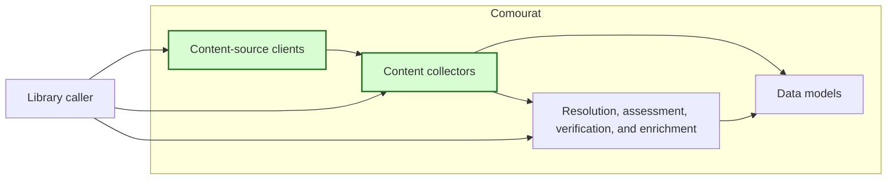
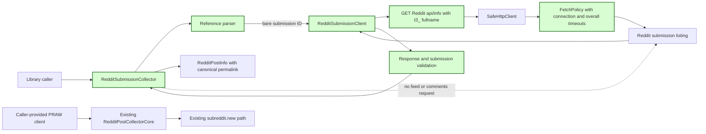

## Collect a specified Reddit post

### 1. Requirement analysis

**R1 — Single-post public interface.** Provide a small public content-collector interface that collects one caller-specified Reddit post. Accept the Reddit client and timeout settings through caller-provided configuration. Do not change the existing subreddit-feed collection behavior.

**R2 — Supported references.** Accept either a bare base36 submission ID or a direct public Reddit post URL. Support Reddit comment permalinks, gallery URLs, and `redd.it` short URLs when they contain a submission ID. Reject blank values, malformed IDs, non-Reddit URLs, unsupported Reddit URLs, and URLs without a submission ID before requesting source content.

**R3 — Submission-only retrieval.** Retrieve only the specified submission. Do not retrieve a subreddit feed to find it. Do not request or access its comments. A link post with empty text is a valid result; the existing feed collector's text filter does not apply to this operation.

**R4 — Result data.** Return one `RedditPostInfo` data model. Preserve the source's subreddit name, bare submission ID, title, author, UTC creation time, text, and score. Set `url` to the canonical Reddit discussion permalink from the source response, not to an external link stored in the submission. Use an absolute `https://www.reddit.com` permalink.

**R5 — Explicit failure outcomes.** Raise `ValueError` for an invalid reference or invalid timeout configuration. Raise `LookupError` when Reddit reports that the submission is unavailable or returns no matching submission. Raise `RuntimeError` for other provider, HTTP, response-format, and source-data failures. Raise `TimeoutError` when the connection or overall operation timeout expires. Preserve the original exception as the cause when an exception is translated. Do not convert a failure into an empty or partial successful result.

**R6 — Bounded source operation.** Provide caller-configurable connection and overall operation timeouts. Use a 10-second connection timeout and a 30-second overall operation timeout by default. Require positive finite values. Apply the connection timeout to each source connection attempt. Include source authentication, request transfer, response transfer, response reading, and any source redirects in the overall operation. Do not let a new connection, redirect, or response read restart the overall timeout.

**R7 — Verification and documentation.** Test every behavior with controlled source doubles or local fixtures without live network access or credentials. Document the public interface, accepted reference forms, result fields, exceptions, timeout defaults, timeout scope, and the guarantee that comments are not collected.

Expected behavior variants:

- **B1 — ID input:** A valid bare submission ID retrieves that exact submission.
- **B2 — URL input:** Each supported Reddit post URL form retrieves the submission identified by the URL.
- **B3 — Canonical result:** A source response with an external submission link still returns the canonical Reddit discussion permalink and all required `RedditPostInfo` fields.
- **B4 — Empty text:** A valid link post with empty `selftext` returns successfully with empty text.
- **B5 — Invalid input:** Each unsupported or malformed reference raises `ValueError` and causes no source request.
- **B6 — Unavailable post:** A missing, deleted, removed, or otherwise unavailable submission raises `LookupError`.
- **B7 — Provider failure:** An HTTP error, provider exception, malformed response, or invalid required source field raises `RuntimeError` with its cause preserved when applicable.
- **B8 — Timeout:** Connection and overall deadline expiration raise `TimeoutError`; tests show that the overall deadline covers the complete source operation.
- **B9 — No comments:** The operation makes no comments request and does not access a comments interface.
- **B10 — Existing behavior:** Existing subreddit-feed collection and its tests remain unchanged.

### 2. Tests

**T1 — Collect by ID and supported URL.** Covers R1, R2, R3, B1, B2, and B9. Parameterize a bare ID, Reddit comment permalinks on supported Reddit hostnames, gallery URLs, and `redd.it` URLs. Use a controlled source double that returns one known submission. Assert that each call retrieves the ID embedded in the reference and returns one `RedditPostInfo`. Assert that the double receives no subreddit-feed or comments request and that no comments interface is accessed.

**T2 — Canonical model mapping.** Covers R4 and B3. Return a submission whose external `url` differs from its `permalink`. Assert the returned bare submission ID, subreddit, title, author, ISO UTC creation time, text, score, and absolute `https://www.reddit.com` discussion permalink. Include a permalink that the source returns as a relative path.

**T3 — Empty link-post text.** Covers R3 and B4. Return a valid link submission with empty `selftext` and an external content URL. Assert successful collection with `text == ""` and the canonical discussion permalink.

**T4 — Invalid references.** Covers R2, R5, and B5. Parameterize blank and non-string values, invalid base36 IDs, non-Reddit URLs, unsupported schemes, unsupported Reddit paths, malformed URLs, and Reddit URLs without a submission ID. Assert `ValueError` and zero source operations for every case.

**T5 — Unavailable submissions.** Covers R5 and B6. Use controlled source outcomes for not-found HTTP responses, an empty submission result, a result whose ID does not match the request, and deleted or removed submission data. Assert `LookupError`, no partial result, and no comments fallback.

**T6 — Provider and response failures.** Covers R5 and B7. Parameterize non-not-found HTTP errors, provider exceptions, connection failures other than timeout, malformed JSON, malformed result containers, and missing or invalid required submission fields. Assert `RuntimeError`. Assert exception chaining where an underlying exception exists and assert that no error is returned as a successful empty result.

**T7 — Timeout configuration and connection deadline.** Covers R1, R5, R6, B8, and B10. Assert the documented 10-second connection and 30-second overall defaults. Parameterize zero, negative, Boolean, NaN, and infinite timeout settings and assert `ValueError` before a source operation. Use a controlled transport to verify the configured connection timeout and translate connection expiration to `TimeoutError` with the original exception preserved.

**T8 — Overall operation deadline.** Covers R5, R6, and B8. Use controlled clocks, events, and local transport doubles to advance time through source authentication, connection, response transfer, redirects, and response-body reading. Assert that each stage receives only the remaining operation time, a redirect or response read receives no new full timeout, and expiration raises `TimeoutError` with its cause preserved. Include a trickled body where individual reads make progress but the complete operation exceeds the deadline. Keep tests fast and independent of live network timing.

**T9 — Caller configuration and isolation.** Covers R1, R6, R7, and B10. Inject different source clients, sessions, and timeout values into concurrent collector instances. Assert that each operation uses only its own configuration, does not change shared client or process-global timeout state, and does not read environment variables or configuration files. Existing feed-collector clock and collection tests must pass unchanged.

**T10 — Regression and offline verification.** Covers R7 and B10. Run the complete test suite with external network access disabled. Confirm that all new and pre-existing tests pass without credentials or live Reddit access and that no new runtime dependency is required. Review the public documentation against R7 and confirm that it describes every accepted input, result, failure, timeout, and no-comments guarantee.

### 3. Implementation plan

#### 3.1 Implementation repos

- `anton-pershin/comourat`: management repository and implementation repository.

#### 3.2 High-level design

The first diagram copies the constitution design and marks the changed components in green. Shared data models and processing components do not change.

The second diagram shows the new single-post path and the existing feed path. The two paths are independent.

`RedditSubmissionClient` accepts a caller-provided Requests session, identifying user agent, Reddit API base URL, connection timeout, and overall operation timeout. It uses `SafeHttpClient` and a `FetchPolicy` to apply both timeouts and the existing protected HTTP behavior. Its default API base URL is `https://www.reddit.com`; callers can provide a session with source authentication headers when required. It requests `api/info/` with one `t3_` submission fullname and does not call PRAW's lazy submission loader.

`RedditSubmissionCollector` accepts the client through its constructor and exposes `collect(reference)`. The parser accepts only the documented ID and direct Reddit URL forms. The client validates HTTP and JSON results. The collector validates the matching submission and maps it to `RedditPostInfo`. Input, unavailable-post, provider, and timeout failures follow R5 without a fallback request.

Add an optional connection timeout to `FetchPolicy`. Its default keeps existing fetch behavior unchanged. The internal deadline timeout view returns the smaller value of the configured connection timeout and the remaining overall time for each connection attempt. Read operations continue to use the remaining overall time. `SafeHttpClient` supplies this policy to its existing adapter, which already covers authentication hooks, redirects, retries, response reading, and socket deadline enforcement.

Keep `RedditPostCollectorCore`, its PRAW dependency, and its feed behavior unchanged. Add focused client and collector tests, shared connection-timeout tests, and public README documentation. Do not add a runtime dependency.
