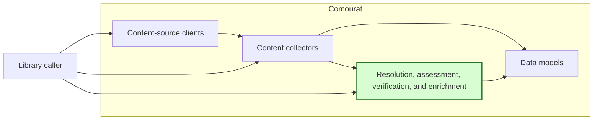
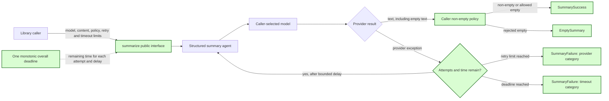

## Public summarization interface

### 1. Requirement analysis

This spec implements GitHub issue #4. Issue #4 defines the required behavior without prescribing an implementation shape. Section 3.2 selects a small public function and result models.

**R1 — Public and explicit configuration.** Callers must be able to configure the model and pass content through supported public interfaces. Callers must not need private Comourat implementation details or a substitute agent. The interfaces must not read model, credential, prompt, retry, or timeout configuration from environment variables or configuration files.

**R2 — Successful provider results.** A public result must represent a successful provider response separately from a provider failure. A successful non-empty response must contain the summary text. Comourat must remove leading and trailing whitespace from that text. A response that is empty or contains only whitespace is an empty provider response.

**R3 — Caller-controlled non-empty validation.** The caller must be able to allow an empty provider response or reject it through a documented policy. An allowed empty response remains a successful provider result with empty summary text. A rejected empty response produces a separate empty-summary outcome. It must not become a provider failure. Applying the policy must not call the provider again. Provider success, caller validation, and provider failure must remain separate layers.

**R4 — Sanitized provider failure.** After the permitted attempts end, a provider failure must produce a public failure result with a stable error category and a sanitized message. Public results must not contain provider-specific exception objects, credentials, request headers, secret-bearing prompts, or raw provider responses. Error text from a provider must not be copied to a public result without sanitization.

**R5 — Independent retry and deadline limits.** The retry count and one overall monotonic deadline must independently limit an operation. A retry count of zero permits one provider attempt. Every provider wait and retry delay must use the same deadline. An attempt or delay must use only the remaining time. No new attempt must start after the deadline. A retry must not reset or extend the deadline. Deadline expiry must produce a sanitized timeout failure and must not become an empty-summary outcome.

**R6 — Documentation and deterministic verification.** Document the public configuration, result outcomes, non-empty policy, sanitization boundary, retry semantics, and overall deadline. Tests must use controlled providers, clocks, and delays. Tests must not need live provider access or credentials. Keep the change within the existing enrichment component and use existing runtime dependencies.

The required behavior has these variants:

- **B1 — Non-empty success without retry.** The first provider attempt returns non-empty text. The public result contains the cleaned summary text and records provider success.
- **B2 — Allowed empty success.** The provider returns an empty or whitespace-only response. The caller allows empty text. The public result remains a successful provider result with empty summary text.
- **B3 — Rejected empty success.** The provider returns an empty or whitespace-only response. The caller requires non-empty text. The public result is the separate empty-summary outcome, with no provider retry and no provider-failure classification.
- **B4 — Success after provider failure.** One provider attempt fails and a later attempt returns non-empty text before either limit ends. The public result contains the summary and records success.
- **B5 — Retry-limit failure.** Every permitted provider attempt fails while time remains. The public result is a sanitized provider failure. The number of attempts agrees with the configured retry count.
- **B6 — Deadline before an attempt.** No time remains before the first or a later attempt. Comourat makes no new provider call and returns a sanitized timeout failure.
- **B7 — Deadline during a provider wait.** A provider wait reaches the overall deadline. The operation ends with a sanitized timeout failure and starts no retry.
- **B8 — Deadline during a retry delay.** The remaining time is shorter than the requested retry delay. The delay uses no more than the remaining time, no later attempt starts, and the result is a sanitized timeout failure.
- **B9 — Independent limits.** A large retry allowance does not extend the deadline. A large deadline does not permit more attempts than the retry count.
- **B10 — Sensitive provider failure.** A provider exception includes secret-like values, request data, prompt text, or raw response text. The public result contains only the stable category and sanitized message and excludes all sensitive values.
- **B11 — Invalid limits.** A negative retry count or a non-positive or non-finite overall timeout is rejected before any provider call.

### 2. Tests

- **T1 — Supported public boundary.** Covers R1 and B1. Import and use only the documented public summarization interfaces. Pass the model and content explicitly. Prove that environment variables and configuration files do not supply or change model, credential, prompt, retry, or timeout settings. Prove that the caller does not construct or access private Comourat types.
- **T2 — Non-empty provider success.** Covers R2 and B1. Return summary text with leading and trailing whitespace from a controlled provider. Assert one provider call, a successful outcome, and trimmed summary text in the public result.
- **T3 — Allowed empty provider success.** Covers R2, R3, and B2. Parameterize empty and whitespace-only provider responses. Configure the policy to allow empty text. Assert a successful provider outcome, empty summary text, no empty-summary rejection, and one provider call.
- **T4 — Rejected empty provider success.** Covers R3 and B3. Parameterize empty and whitespace-only provider responses. Configure the policy to require non-empty text. Assert the separate empty-summary outcome, no provider failure, and exactly one provider call even when retries remain.
- **T5 — Success after a provider failure.** Covers R4, R5, and B4. Fail the first controlled provider attempt and return non-empty text from the second attempt. Assert two calls, trimmed summary text, and a final successful outcome.
- **T6 — Retry-limit provider failure.** Covers R4, R5, B5, and B9. Fail every attempt with a large deadline and retry counts of zero and two. Assert exactly one and three calls respectively. Assert the documented provider-failure category and sanitized message.
- **T7 — Deadline prevents a new attempt.** Covers R5, B6, and B9. Use a controlled clock with no time remaining before the first attempt. Assert no provider call and a sanitized timeout failure. Repeat with time remaining for the first attempt but not for a later attempt. Assert that only the first provider call occurs.
- **T8 — Deadline ends a provider wait.** Covers R5 and B7. Use a controlled provider wait and clock that reach the overall deadline during an attempt. Assert that the operation waits no longer than the remaining time, returns a sanitized timeout failure, and starts no retry.
- **T9 — Deadline bounds a retry delay.** Covers R5, B8, and B9. Fail the first attempt and request a retry delay longer than the remaining time. Use a controlled sleeper and clock. Assert that the delay uses no more than the remaining time, no second provider call starts, and the result is a sanitized timeout failure.
- **T10 — Retry count and deadline are independent.** Covers R5 and B9. Run one case with many permitted retries and a short deadline and another with a long deadline and few permitted retries. Prove that either limit can end the operation and that neither limit increases the other limit.
- **T11 — Public failure sanitization.** Covers R4 and B10. Raise provider exceptions containing secret-like credentials, request-header values, prompt text, and raw response text. Assert that the public result has no provider-specific exception object or raw response and contains none of the sensitive values. Assert only the stable category and documented sanitized message.
- **T12 — Invalid limit handling.** Covers R5 and B11. Parameterize negative retry counts and zero, negative, NaN, and infinite overall timeouts. Assert rejection before any provider call.
- **T13 — Offline regression verification and documentation.** Covers R6. Run the new tests and the complete existing test suite with live provider access disabled and no credentials. Verify that the public documentation describes explicit configuration, all outcomes, both non-empty policies, sanitization, retry counting, the overall deadline, and invalid limits.

### 3. Implementation plan

#### 3.1 Implementation repos

- `anton-pershin/comourat`: management repository and implementation repository.

#### 3.2 High-level design

The first diagram copies the constitution design and marks the changed processing component in green.



The second diagram shows the public summarization boundary inside the existing enrichment component.



The public module is `comourat.enrichment.summarizer`. It exposes `summarize`, `SummarySuccess`, `EmptySummary`, `SummaryFailure`, and the `SummaryResult` union. The three result models use Pydantic and have a literal `outcome` field for type discrimination:

- `SummarySuccess` has outcome `success` and a `summary` string. The string can be empty only when the caller allows empty text.
- `EmptySummary` has outcome `empty` and an empty `summary` string. It means that the provider succeeded but the caller rejected empty text.
- `SummaryFailure` has outcome `failure`, an `error_category` of `provider` or `timeout`, and an `error_message`. Messages are fixed Comourat text and contain no provider error text or input content.

The public function has this behavioral signature:

```python
summarize(
    model,
    content,
    *,
    system_prompt=DEFAULT_SYSTEM_PROMPT,
    model_settings=None,
    require_non_empty=True,
    retries=1,
    retry_delay=0.0,
    overall_timeout=30.0,
) -> SummaryResult
```

The default non-empty policy preserves the current rejection of empty summaries, but returns `EmptySummary` instead of raising an exception. Setting `require_non_empty=False` returns `SummarySuccess(summary="")` for an empty provider response. The retry count excludes the first attempt. The default retry delay preserves the current immediate retry behavior. The default overall timeout is 30 seconds.

The implementation computes one deadline before the first attempt. Each `Agent.run_sync` call receives the remaining time through its `timeout` argument. The implementation checks the clock after a provider call so a late result cannot become success. Each retry delay sleeps for no more than the remaining time. It checks the deadline before every attempt. A provider success goes directly to the non-empty policy and never enters the provider-failure retry path.

The existing `_create_summary_agent` and `_SummaryOutput` remain private implementation details. The existing `summarize_with_events` interface remains available and unchanged for current callers. The new public function uses the same private agent factory but does not expose provider exceptions, raw responses, or event dictionaries. No new runtime dependency is needed. The existing `pydantic-ai` dependency requires version 2.64.0 or later for per-run timeout support.
