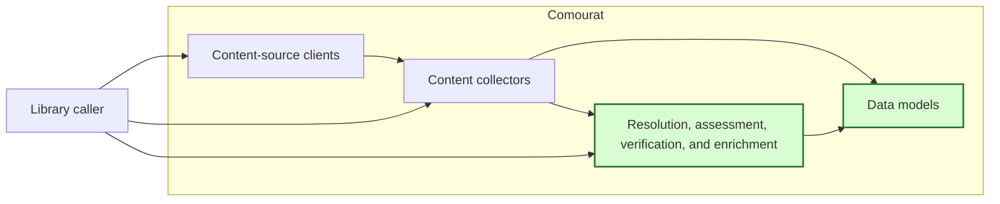

## Article extraction result and error contract

### 1. Requirement analysis

This spec implements GitHub issue #6. The interface supports research-related public blog and article pages linked to collected content.

**R1 — Public article result.** `PageFetcher.fetch` must accept one article URL and return an `ArticleResult` Pydantic model on success. The model must contain non-empty `title`, `source_url`, and `text` fields. The text must be the extracted article text without summarization. Leading and trailing whitespace must be removed from the title and text. The source URL must be the final response URL after redirects when the response supplies one; otherwise, it must be the validated input URL.

**R2 — Title and text extraction.** Use Trafilatura metadata for the default title. If it has no title, use the HTML document title and then the first `h1` heading as fallbacks. Use the existing main-content extractor for the text. Keep the text extractor injectable and make the title extractor injectable through the constructor. Do not add a summarizer or a runtime dependency.

**R3 — Stable public failures.** Replace expected `None` failures with `ArticleFetchError`. The exception must have a stable string `category` and a fixed public message that does not contain source response content, provider exception text, URL userinfo, paths, queries, or credentials. Use these categories: `invalid_input`, `unsupported_scheme`, `unavailable`, `empty_extraction`, `timeout`, `provider`, and `extraction`. Invalid constructor configuration must continue to raise its existing configuration exception.

**R4 — Input and source failures.** Reject a non-string, blank, or malformed URL, a URL without a host, and an invalid port as `invalid_input` before a source request. Reject a non-HTTP or non-HTTPS scheme as `unsupported_scheme` before a source request. Classify a local fetch-policy denial as `invalid_input`, except for an unsupported scheme found during a redirect. Classify HTTP 404 and 410 as `unavailable`. Classify other non-success HTTP responses, DNS failures, connection failures, and other source request failures as `provider`, unless they are timeouts.

**R5 — Extraction outcomes.** Classify connection, read, and overall-deadline expiry as `timeout`. Classify a title or text extractor exception and an invalid extractor return type as `extraction`. Classify a missing, empty, or whitespace-only title or text as `empty_extraction`. Do not return a partial article or convert an error into an empty success.

**R6 — Bounded operation.** Provide direct `connection_timeout` and `operation_timeout` constructor settings with 10-second and 30-second defaults. Preserve `timeout` as an alias for `operation_timeout`. Do not combine direct timeout settings or `timeout` with `fetch_policy`. The connection timeout must cap each connection attempt without exceeding the remaining operation time. The operation timeout must include source retrieval, redirects, retries, response transfer, and the wait for local title and text extraction. Each stage must use only the remaining time. A late extraction result must produce `timeout`, not success. Use the existing protected fetch policy and do not weaken its URL, DNS, proxy, redirect, or destination controls.

**R7 — Verification and documentation.** Use mocked responses, controlled extractors, clocks, and events. Tests must not require live network access. Document the public result, all failure categories, timeout defaults and scope, redirect source URL behavior, and the absence of summarization. Keep existing protected-fetch security checks and unrelated behavior intact.

Expected behavior variants:

- **B1 — Complete success.** A valid response with a title and main text returns one complete article without summarization.
- **B2 — Title fallback.** Missing Trafilatura metadata uses the HTML title or first `h1` heading.
- **B3 — Redirect source.** A redirected response returns its final URL as `source_url`.
- **B4 — Invalid input.** Malformed input and local policy denials produce `invalid_input` without an unprotected request.
- **B5 — Unsupported scheme.** A direct or redirected non-HTTP(S) target produces `unsupported_scheme`.
- **B6 — Unavailable content.** HTTP 404 and 410 produce `unavailable`.
- **B7 — Provider failure.** Other HTTP, DNS, connection, and source request failures produce `provider`.
- **B8 — Timeout.** A connection timeout, source read timeout, overall source deadline, or extraction wait deadline produces `timeout`.
- **B9 — Extraction failure.** A title or text extractor exception or invalid return type produces `extraction`.
- **B10 — Empty extraction.** A missing or blank title or text produces `empty_extraction` and no partial result.
- **B11 — Independent time limits.** The connection setting limits each attempt, while the operation setting limits the complete call. Neither limit extends the other.
- **B12 — Existing protections.** Protected URL, proxy, redirect, DNS, and response-transfer behavior continues to pass its existing tests.

### 2. Tests

- **T1 — Complete public result.** Covers R1, R2, and B1. Call `PageFetcher.fetch` with a controlled response and extractors. Assert the Pydantic result type, trimmed non-empty title and text, source URL, and exact unsummarized extractor text.
- **T2 — Default title extraction and fallbacks.** Covers R2, B1, and B2. Use controlled HTML to verify Trafilatura metadata, HTML-title fallback, and `h1` fallback. Verify that the default main-content extractor returns article text.
- **T3 — Final source URL.** Covers R1 and B3. Supply a response URL that differs from the input URL and assert that the result uses it. Also verify the input-URL fallback.
- **T4 — Invalid URL matrix.** Covers R3, R4, and B4. Parameterize non-string, blank, malformed, hostless, and invalid-port values. Assert `invalid_input`, a fixed sanitized message, and zero session requests.
- **T5 — Unsupported schemes and policy denials.** Covers R3, R4, B4, and B5. Parameterize direct unsupported schemes and assert `unsupported_scheme` with zero session requests. Use controlled policy failures for denied targets and unsupported redirect schemes.
- **T6 — Unavailable and provider HTTP failures.** Covers R3, R4, B6, and B7. Assert `unavailable` for 404 and 410. Assert `provider` for representative 4xx, 5xx, invalid, and non-success redirect responses.
- **T7 — Source provider failures.** Covers R3, R4, and B7. Parameterize DNS, connection, invalid-response, and other source request exceptions. Assert `provider` and no partial article.
- **T8 — Source timeouts.** Covers R3, R5, R6, and B8. Parameterize connection, read, and overall-deadline exceptions. Assert `timeout` and no extraction call after the source timeout.
- **T9 — Extraction exceptions and return types.** Covers R3, R5, and B9. Fail each extractor independently and return non-text values. Assert `extraction` and a sanitized fixed message.
- **T10 — Empty title or text.** Covers R3, R5, and B10. Parameterize missing, empty, and whitespace-only titles and texts. Assert `empty_extraction` and no `ArticleResult`.
- **T11 — Timeout configuration and connection limit.** Covers R6 and B11. Assert the 10-second and 30-second defaults, alias behavior, custom policy behavior, and invalid timeout rejection. Verify that the adapter receives the configured connection timeout bounded by the remaining operation time.
- **T12 — Overall deadline includes extraction.** Covers R6, B8, and B11. Use controlled clocks and blocking extractors. Prove that extraction waits only for the remaining time and that a late result becomes `timeout` without another source request.
- **T13 — Protected-fetch regressions.** Covers R6, R7, and B12. Update article-entry assertions to the new result and exception contract. Run the direct, proxy, redirect, DNS-change, logging-redaction, and resource-cleanup security tests.
- **T14 — Documentation and full offline suite.** Covers R7. Verify the README contract and run the complete test suite in `/home/tony/venvs/comourat` without live network access.

### 3. Implementation plan

#### 3.1 Implementation repos

- `anton-pershin/comourat`: management repository and implementation repository.

#### 3.2 High-level design

The first diagram copies the constitution design and marks the changed components in green.



The second diagram shows the article boundary inside the existing enrichment component.

```mermaid
flowchart LR
  Caller[Library caller] --> Fetch[PageFetcher.fetch]
  Fetch --> Validate[Input validation]
  Validate --> Client[SafeHttpClient]
  Client --> Source[Public article source]
  Source --> Status{HTTP and transport result}
  Status -->|404 or 410| Unavailable[unavailable]
  Status -->|timeout| Timeout[timeout]
  Status -->|other failure| Provider[provider]
  Status -->|success HTML| Extract[Bounded title and text extraction]
  Extract -->|complete| Result[ArticleResult]
  Extract -->|blank fields| Empty[empty_extraction]
  Extract -->|extractor failure| Extraction[extraction]
  Extract -->|deadline reached| Timeout
  Validate -->|malformed or denied| Invalid[invalid_input]
  Validate -->|non-HTTP(S)| Scheme[unsupported_scheme]
  Deadline[One operation deadline] -.remaining time.-> Client
  Deadline -.remaining wait.-> Extract
  class Fetch,Validate,Extract,Result,Unavailable,Timeout,Provider,Empty,Extraction,Invalid,Scheme,Deadline changed;
  classDef changed fill:#d9fdd2,stroke:#267326,stroke-width:2px;
```

`ArticleResult` is a neutral Pydantic model in `comourat.models`. `ArticleFetchError` and the extraction helpers remain in `comourat.enrichment.page_fetch`. `PageFetcher` translates expected source and extraction failures into the public categories. It uses one monotonic operation start time and the existing `SafeHttpClient` deadline controls. A bounded wait discards late local extraction output. Fixed error messages protect source and provider details. No summarization component participates in this path.
