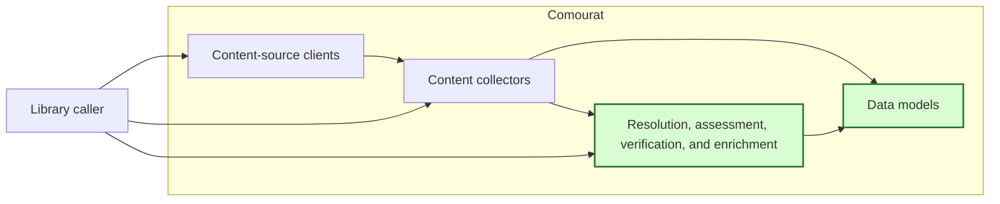
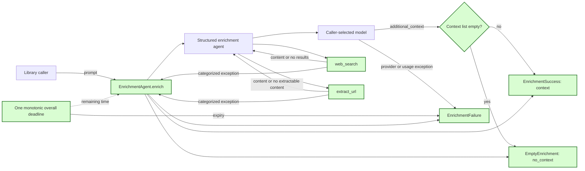

## Reliable enrichment outcomes

### 1. Requirement analysis

This spec implements GitHub issue #7. It changes the public result of `EnrichmentAgent.enrich`. It does not change summarization, paper discovery, or the fetch-policy rules.

**R1 — Explicit public outcomes.** `EnrichmentAgent.enrich` must return one of three Pydantic result models. A context result has outcome `context` and a non-empty `additional_context` list. An empty result has outcome `no_context` and an empty `additional_context` list. A failure result has outcome `failure`, a stable error category, and a sanitized error message. The `EnrichmentResult` public type must be the discriminated union of these models. The provider must not select the public outcome.

**R2 — Search and fetch failures.** Enrichment web tools must report search and URL-extraction exceptions to `EnrichmentAgent`. They must not convert these exceptions into ordinary model text. A failed search or fetch must produce a failure result with the corresponding category. A successful search with no results and a successful fetch with no extractable content are not failures. They can lead to the `no_context` outcome. The existing string-returning behavior of directly attached web tools used by paper discovery must remain unchanged.

**R3 — Provider and usage-limit failures.** A provider exception must produce a sanitized failure result with category `provider`. A request or tool-call usage-limit exception must produce a sanitized failure result with category `usage_limit`. Public failure results must not contain exception objects, provider error text, credentials, request data, prompts, URLs with sensitive components, or raw responses.

**R4 — One overall deadline.** `EnrichmentAgent` must accept an explicit `overall_timeout` argument with a default of 120 seconds. One monotonic deadline must cover the complete agent run, including model requests, web tools, and output validation. The agent run must receive only the remaining time. A result produced after the deadline must not become a context or no-context result. Deadline expiry must produce a sanitized failure result with category `timeout`. Existing fetch policies continue to bound individual HTTP requests. The timeout must be positive and finite. Invalid values must raise `ValueError` before agent creation or execution.

**R5 — Documentation and verification.** Document the public result models, error categories, sanitization boundary, default timeout, deadline scope, and invalid timeout behavior. Use controlled agents, tools, and clocks in tests. Tests must not require live network access, provider access, or credentials. Use existing runtime dependencies.

The required behavior has these variants:

- **B1 — Context returned.** The provider returns one or more context points and no operation fails. The result has outcome `context` and contains those points.
- **B2 — Successful no-context.** The provider returns an empty list and no operation fails. The result has outcome `no_context`.
- **B3 — Empty tool results.** Search returns no results or extraction returns no extractable content without an exception. These tool results do not cause a failure by themselves.
- **B4 — Search failure.** Web search raises an exception. Public enrichment returns category `search`, not `no_context`.
- **B5 — Fetch failure.** URL extraction raises an exception. Public enrichment returns category `fetch`, not `no_context`.
- **B6 — Provider failure.** The agent raises a provider or output-processing exception. Public enrichment returns category `provider`.
- **B7 — Usage-limit failure.** The agent raises `UsageLimitExceeded`. Public enrichment returns category `usage_limit`.
- **B8 — Deadline expiry.** The agent run raises a timeout or returns after the overall deadline. Public enrichment returns category `timeout` and does not expose late output.
- **B9 — Sensitive failure data.** An exception contains credentials, request data, prompt text, a sensitive URL, or raw response text. The public result contains only its stable category and fixed Comourat message.
- **B10 — Invalid timeout.** A zero, negative, non-finite, non-numeric, or Boolean overall timeout is rejected before an agent is created or called.
- **B11 — Unrelated behavior.** Summarization and direct web-tool use by paper discovery keep their existing result behavior.

### 2. Tests

- **T1 — Context result.** Covers R1 and B1. Use a controlled structured agent with non-empty context. Assert the result type, outcome, context values, and discriminated-union serialization round trip.
- **T2 — No-context result.** Covers R1 and B2. Use a controlled structured agent with an empty list. Assert the result type, outcome, and empty context. Prove that this result is not a failure.
- **T3 — Empty tool results are successful tool calls.** Covers R2 and B3. Use controlled HTTP responses with no search results and no extractable article content. Assert ordinary no-result tool text and no raised tool error.
- **T4 — Search failure is public and categorized.** Covers R2, R3, B4, and B9. Make search fail through the enrichment tool boundary and through `EnrichmentAgent.enrich`. Assert category `search`, the fixed message, and no successful empty result.
- **T5 — Fetch failure is public and categorized.** Covers R2, R3, B5, and B9. Make URL extraction fail through the enrichment tool boundary and through `EnrichmentAgent.enrich`. Assert category `fetch`, the fixed message, and no successful empty result.
- **T6 — Provider and usage-limit failures.** Covers R3, B6, and B7. Make controlled agents raise provider, malformed-output, and usage-limit exceptions. Assert their public categories and fixed messages.
- **T7 — Public failure sanitization.** Covers R3 and B9. Put secret-like values in search, fetch, and provider exceptions. Inspect the public result representation and JSON. Assert that no sensitive value or exception object is present.
- **T8 — Overall deadline.** Covers R4 and B8. Assert that the agent run receives the configured remaining timeout. Use controlled timeout exceptions and a late agent result. Assert category `timeout` and no late context or no-context result.
- **T9 — Invalid timeout handling.** Covers R4 and B10. Parameterize zero, negative, NaN, infinite, non-numeric, and Boolean values. Assert `ValueError` before agent creation or execution.
- **T10 — Scope and regression verification.** Covers R2, R5, and B11. Verify that paper-discovery web tools keep their existing error-string behavior and summarization tests remain unchanged. Run the complete test suite offline. Verify the README contract and all fixed public messages.

### 3. Implementation plan

#### 3.1 Implementation repos

- `anton-pershin/comourat`: management repository and implementation repository.

#### 3.2 High-level design

The first diagram copies the constitution design and marks the changed data models and processing component in green.

The second diagram shows the authoritative public outcome boundary around the structured enrichment agent.

`comourat.models` exposes `EnrichmentSuccess`, `EmptyEnrichment`, `EnrichmentFailure`, and the discriminated `EnrichmentResult` union. `EnrichmentSuccess` has a non-empty `additional_context` list. `EmptyEnrichment` permits only an empty list. `EnrichmentFailure` has an `error_category` of `search`, `fetch`, `provider`, `usage_limit`, or `timeout` and a fixed `error_message`.

`comourat.enrichment.enricher` uses a private `_EnrichmentOutput` model for provider output. This model keeps the existing `additional_context` field. `create_enrichment_agent` attaches web tools in exception-propagating mode. A private web-tool exception carries only the `search` or `fetch` category. `attach_web_tools` keeps its current string-returning default for other callers.

`EnrichmentAgent.enrich` validates output and selects the public outcome. It catches categorized tool exceptions, `UsageLimitExceeded`, timeout exceptions, and other provider exceptions. It returns fixed public messages and never returns raw exception data. Existing callers that construct `EnrichmentResult` as one model must instead construct one of the three public result models.

The `overall_timeout` value is stored on `EnrichmentAgent`. Each `enrich` call computes one monotonic deadline. `Agent.run_sync` receives the remaining time through its `timeout` argument, which covers the whole run and its tools. A clock check before the run prevents a late start. A clock check after the run prevents late output from becoming success. No new runtime dependency is needed.
