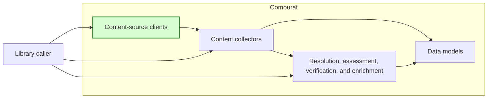
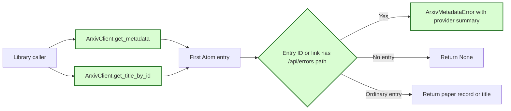

## Handle arXiv Atom error entries

### 1. Requirement analysis

**R1 — Provider error detection.** Update `ArxivClient.get_metadata` and `ArxivClient.get_title_by_id` to detect an arXiv error entry through its entry ID or link. The marker is a URL with the documented `/api/errors` path. Do not use the entry title as the error marker.

**R2 — Explicit provider failures.** When either method detects an arXiv error entry, raise `ArxivMetadataError`. Include the non-empty provider summary in the exception message as diagnostic context. Do not return the error title, summary, or a paper record as a successful result.

**R3 — Paper and empty-feed behavior.** Continue to return `None` for an empty feed. Treat an ordinary paper entry titled `Error` as a paper when its entry ID and links do not contain the `/api/errors` marker. Preserve the existing metadata, title normalization, reference validation, HTTP, transport, and deadline behavior outside this change.

**R4 — Documentation.** Document the error-entry contract for both public methods in the README and method documentation. State that the provider summary is diagnostic context and that an ordinary paper can have the title `Error`.

Expected behavior variants:

- **B1 — Error entry ID.** The entry ID contains the `/api/errors` marker. Both methods raise `ArxivMetadataError`.
- **B2 — Error link.** An entry link contains the `/api/errors` marker when the entry ID does not. Both methods raise `ArxivMetadataError`.
- **B3 — Provider diagnostic.** The error summary contains provider diagnostic text. The exception message contains that text.
- **B4 — Unknown paper.** An empty feed returns `None` from both methods.
- **B5 — Paper titled Error.** An ordinary paper entry titled `Error` returns its metadata or title according to the called method.
- **B6 — Existing behavior.** Existing arXiv and unrelated client behavior remains compatible.

### 2. Tests

Add mocked regression tests to `tests/test_comourat_clients.py`. Do not use live network access.

- **T1 — Error entry ID.** Covers R1, R2, B1, and B3. For each public method, return an HTTP 200 Atom feed with an `/api/errors` entry ID and a provider summary. Assert `ArxivMetadataError` and assert that the exception message contains the summary.
- **T2 — Error link.** Covers R1, R2, B2, and B3. For each public method, use an entry ID without the error marker and an entry link with the marker. Assert the same failure contract as T1.
- **T3 — Paper titled Error.** Covers R1, R3, and B5. Return an ordinary paper entry titled `Error` with a normal entry ID and link. Assert that `get_metadata` returns a paper record with that title and that `get_title_by_id` returns `Error`.
- **T4 — Unknown paper.** Covers R3 and B4. Keep or add tests that assert `None` from both methods for an empty feed.
- **T5 — Documentation.** Covers R4. Verify that the README identifies both public methods, the `/api/errors` marker, `ArxivMetadataError`, provider-summary diagnostics, empty-feed results, and ordinary papers titled `Error`.
- **T6 — Full regression suite.** Covers R3 and B6. Run the complete test suite in the project Python environment. Confirm that all tests pass without live network access.

### 3. Implementation plan

#### 3.1 Implementation repos

- `anton-pershin/comourat`: management repository and implementation repository.

#### 3.2 High-level design

The first diagram copies the constitution design and marks the changed content-source client in green. The shared data models do not change.

The second diagram shows the shared error-entry check used by the two changed public methods.

A small helper will inspect the entry ID and link URLs. Both public methods will call this helper before they return entry data. The helper will raise the existing `ArxivMetadataError` type. No new dependency or public interface is necessary.
