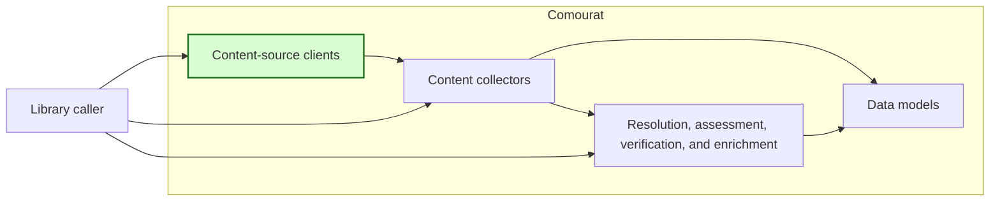
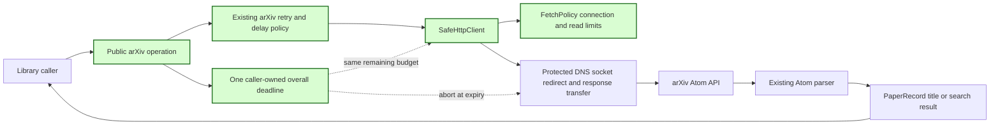

## arXiv metadata overall deadline

### 1. Requirement analysis

This spec implements GitHub issue #15.

**R1 — Enforced overall deadline.** Use one overall deadline for each public arXiv metadata, title-lookup, and title-search operation. The deadline must include DNS resolution, connection setup, redirects, response headers, response body transfer, retries, backoff, politeness delays, and response parsing. Return control promptly after expiry. Raise `requests.Timeout` or its existing `FetchDeadlineExceeded` subtype.

**R2 — Shared protected transport.** Use `SafeHttpClient` and `FetchPolicy` for the default arXiv HTTP transport. Reuse their DNS, socket, redirect, and response-transfer deadline controls. Do not add a separate network-deadline implementation to `ArxivClient`.

**R3 — One deadline across retries.** All HTTP attempts in one public operation must use the same overall deadline. A `SafeHttpClient` call must not start a new overall deadline or close the caller-owned deadline when arXiv supplies one. Redirects and adapter retries must continue to use the active deadline.

**R4 — Existing configuration.** Preserve `timeout_seconds`, `overall_timeout_seconds`, retry settings, proxy support, injected HTTP clients, return values, and documented exception behavior. `timeout_seconds` must continue to cap each connection attempt and each read without exceeding the remaining overall time. Add an optional read limit to the shared fetch policy for this purpose. Its default must preserve the existing overall-deadline-only behavior of `SafeHttpClient`.

**R5 — Verification and documentation.** Use deterministic clocks and controlled local transports. Verify blocking DNS, redirects, retries, trickled response bodies, and valid responses within budget. Tests must not require live network access. Document the enforced stages and the relationship between the two arXiv timeout settings. Keep unrelated fetch-policy and client behavior intact.

Expected behavior variants:

- **B1 — Blocking DNS.** DNS resolution returns control at the overall deadline. A late DNS answer does not cause a connection.
- **B2 — Redirect or retry delay.** Time used before a redirect or retry reduces the budget available to later stages.
- **B3 — Trickled response.** Regular response bytes do not restart or extend the overall deadline.
- **B4 — Valid response.** A complete valid Atom response within budget returns the same paper metadata as before.
- **B5 — Existing interfaces.** Mocked clients, timeout validation, retries, proxy validation, title lookup, and title search remain compatible.

### 2. Tests

- **T1 — Existing arXiv contract.** Covers R4, R5, and B5. Run the existing mocked arXiv tests. Keep the remaining-budget, backoff, parsing, exception, and timeout-validation checks. Add a regression check that the default client constructs the shared protected transport.
- **T2 — Blocking DNS.** Covers R1, R2, R5, and B1. Use a controlled resolver that blocks beyond a short overall timeout. Call `get_metadata` through the real protected transport and a loopback-only test policy. Assert prompt `requests.Timeout`, then release the resolver and wait for the worker result before asserting that no request reaches the controlled server. Repeat the check with an injected `SafeHttpClient` whose own policy has a longer timeout. Also verify that resolver failures retain the existing connection-error retry policy.
- **T3 — Redirect deadline.** Covers R1, R2, R5, and B2. Delay a redirect and its final response so that each stage fits within the full timeout but their total does not. Assert prompt timeout, the expected controlled request count, and that the client returns before the final response is sent.
- **T4 — Retry deadline.** Covers R1, R3, R5, and B2. Delay a retryable response and the following valid response so that each attempt fits within the full timeout but their total does not. Assert timeout during the second attempt and that the client returns before the final response is sent. This check fails if the second attempt receives a new deadline.
- **T5 — Trickled response.** Covers R1, R2, R5, and B3. Send a valid Atom response one small chunk at a time. Make each read interval shorter than the read limit but the total transfer longer than the overall limit. Assert prompt timeout.
- **T6 — Successful response.** Covers R1, R4, R5, and B4. Return a valid Atom response within budget through the controlled transport. Assert the normalized paper record and no timeout.
- **T7 — Shared timeout behavior.** Covers R3 and R4. Verify that the optional fetch-policy read limit is validated, caps each read at the smaller of its value and the remaining overall time, survives timeout cloning, and keeps its default disabled. Verify that an externally supplied deadline is not closed by `SafeHttpClient`. Use a stalled TLS handshake to verify that the connection limit applies after TCP connection setup.
- **T8 — Documentation and full regression suite.** Covers R4 and R5. Verify the README timeout contract. Run the complete suite in `/home/tony/venvs/comourat` without live network access.

### 3. Implementation plan

#### 3.1 Implementation repos

- `anton-pershin/comourat`: management repository and implementation repository.

#### 3.2 High-level design

The first diagram copies the constitution design and marks the changed content-source client in green.

The second diagram shows the arXiv client and the shared fetch components. Green marks changed behavior.

`ArxivClient` creates the overall deadline and closes it when the public operation ends. Its default transport is `SafeHttpClient`. An internal call option lets the client supply this deadline to each attempt. `SafeHttpClient` closes only deadlines that it creates. `FetchPolicy` gains an optional read limit so that arXiv can preserve `timeout_seconds`. The existing watchdog remains authoritative when repeated reads make progress.
