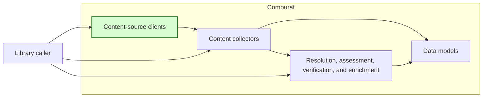
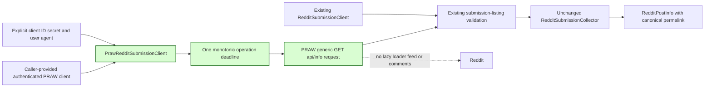

## Authenticated single-post Reddit retrieval

### 1. Requirement analysis

This spec implements GitHub issue #18.

**R1 — Authenticated client interface.** Add a public `PrawRedditSubmissionClient` with the same `fetch_submission(submission_id)` interface as `RedditSubmissionClient`. Accept either a caller-provided authenticated `praw.Reddit` client or explicit OAuth constructor arguments: client ID, client secret, and user agent. Require exactly one of these configuration forms. Keep `RedditSubmissionCollector.collect(reference)` unchanged and keep the existing public JSON client available.

**R2 — Explicit configuration.** Comourat must not read credentials from environment variables or configuration files. Use only the supplied PRAW client or the supplied OAuth arguments for authentication. Do not log or include credential values in public failure messages.

**R3 — Submission-only retrieval.** Use PRAW's generic request interface to retrieve `/api/info/` for one `t3_` submission fullname. Do not use the lazy submission loader, a subreddit feed, or a comments endpoint. Reuse the existing submission-listing validation and collector mapping. Preserve canonical permalinks and all `RedditPostInfo` fields. Do not change subreddit-feed collection.

**R4 — Explicit and sanitized failures.** Preserve `ValueError` for invalid configuration or submission IDs, `LookupError` for unavailable submissions, `RuntimeError` for other provider and response failures, and `TimeoutError` for timeout expiry. Map PRAW not-found and HTTP 410 responses to `LookupError`. Detect request timeouts wrapped by PRAW. Use fixed public messages that do not copy provider exception text. Preserve the original exception as the cause when an exception is translated.

**R5 — Overall operation deadline.** Provide a positive finite `operation_timeout` with a 30-second default. Apply one monotonic deadline to the complete PRAW operation, including token acquisition or refresh and the submission request. Configure a Comourat-created PRAW client with this request timeout. Reject a result or failure that arrives after the deadline as `TimeoutError`. Preserve the caller-provided transport configuration of an injected PRAW client.

**R6 — Verification and documentation.** Use controlled PRAW doubles, controlled clocks, and dummy credentials. Do not use live network access or real credentials. Document both authentication forms, secure caller handling of secrets, the unchanged collector interface, submission-only behavior, failure outcomes, and the timeout contract.

Expected behavior variants:

- **B1 — Injected PRAW client:** The authenticated client delegates one submission-listing request to the exact injected PRAW client and returns the validated submission data.
- **B2 — Explicit OAuth configuration:** Comourat constructs a PRAW client with only the supplied OAuth values and the configured request timeout.
- **B3 — Unavailable submission:** A PRAW not-found response, HTTP 410 response, or empty listing raises `LookupError`.
- **B4 — Provider failure:** Another PRAW or provider failure raises `RuntimeError` with a fixed message and the original cause.
- **B5 — Timeout:** A direct or PRAW-wrapped request timeout, or completion after the operation deadline, raises `TimeoutError`.
- **B6 — Existing behavior:** Public JSON retrieval, canonical model mapping, reference validation, and subreddit-feed collection remain compatible.

### 2. Tests

- **T1 — Injected authenticated delegation.** Covers R1, R3, and B1. Inject a controlled PRAW double that returns one valid listing. Assert one generic PRAW request with method `GET`, path `/api/info/`, and one `t3_` submission ID. Assert that the lazy submission loader, subreddit interface, and comments interface are not accessed. Collect through the unchanged `RedditSubmissionCollector` and assert the canonical `RedditPostInfo` result.
- **T2 — Explicit OAuth construction.** Covers R1, R2, R5, and B2. Replace the PRAW constructor with a controlled double. Assert that the client ID, client secret, user agent, update-check setting, and request timeout are passed explicitly. Assert that different instances retain their own clients and timeout settings and that Comourat performs no environment or file credential lookup.
- **T3 — Configuration validation.** Covers R1, R2, R4, and R5. Test a missing configuration, mixed injected and OAuth configuration, incomplete OAuth arguments, blank values, and invalid timeout values. Assert `ValueError` before authentication or source retrieval.
- **T4 — Unavailable and malformed results.** Covers R3, R4, B3, and B6. Use controlled PRAW not-found and HTTP 410 exceptions, an empty listing, a mismatched submission, and malformed listing data. Assert the same `LookupError` and `RuntimeError` outcomes as the public JSON client.
- **T5 — Sanitized provider failures.** Covers R2, R4, and B4. Use provider and PRAW exceptions whose text contains dummy client secrets, access tokens, URLs, and provider response text. Assert fixed public `RuntimeError` messages, no sensitive text in the public message, and preservation of the original cause.
- **T6 — Timeout behavior.** Covers R4, R5, and B5. Parameterize direct `requests.Timeout`, built-in `TimeoutError`, and a PRAW request exception wrapping a timeout. Use a controlled clock to return an otherwise valid result after the deadline. Assert one public `TimeoutError` outcome and no late successful result.
- **T7 — Existing retrieval regression tests.** Covers R3, R4, R5, and B6. Run the existing single-post and feed-collector tests without changes to their public calls. Confirm that public JSON transport, canonical permalinks, reference validation, timeout settings, and feed behavior remain compatible.
- **T8 — Documentation and offline suite.** Covers R6 and B6. Review both README authentication examples and the secure secret-handling guidance. Run the complete test suite in `/home/tony/venvs/comourat` without live network access or real credentials.

### 3. Implementation plan

#### 3.1 Implementation repos

- `anton-pershin/comourat`: management repository and implementation repository.

#### 3.2 High-level design

The first diagram copies the constitution design and marks the changed content-source client in green. The collector interface and data models do not change.

The second diagram shows the two interchangeable single-post clients. Green marks the new authenticated path.

`PrawRedditSubmissionClient` is a sibling of `RedditSubmissionClient`. It reuses the existing static listing extractor so both transports produce the same submission dictionary. Its constructor stores an injected PRAW client or creates one from explicit OAuth arguments. It uses the generic PRAW request method rather than `praw.Reddit.submission`, whose lazy loader also retrieves comments.

The authenticated client checks one monotonic deadline around the complete PRAW call. A Comourat-created PRAW client receives the configured request timeout. An injected PRAW client keeps its own transport settings. Exception translation examines PRAW response status codes and wrapped transport errors without copying their text into public messages.

The change is limited to the Reddit client module, a collector type annotation that accepts either single-post client, focused deterministic tests, and README documentation. The collector's call interface, feed implementation, data models, and public JSON transport do not require modification.
