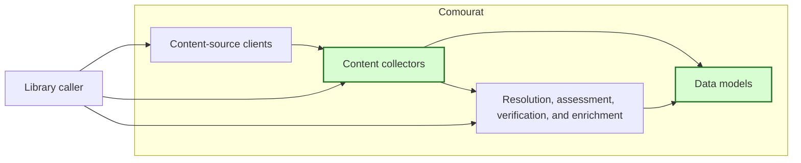
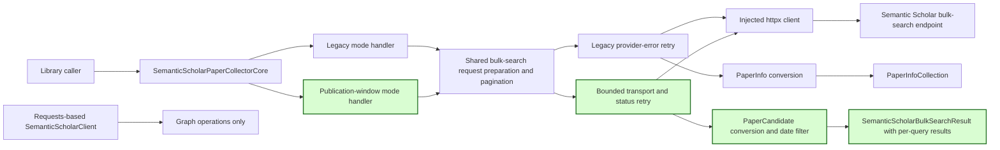

## Semantic Scholar publication-window collection

### 1. Requirement analysis

This spec implements GitHub issue #22.

**R1 — Explicit publication-window collection.** Extend `SemanticScholarPaperCollectorCore` with a `publication_window` mode. The caller must supply one or more non-empty keyword queries and an inclusive publication start date and end date through constructor arguments. The collector must remove whitespace around each query. It must reject an empty query list, blank queries, a missing date, and a start date after the end date. It must use the same date range for every query. It must not calculate lag, stride, backfill, or reference dates.

**R2 — Shared bulk-search machinery.** Keep all Semantic Scholar bulk-search requests in the existing collector-core `httpx` transport. Extend the existing request preparation, continuation-token, and local-cap machinery for both the legacy modes and the new mode. Do not add a second bulk-search transport. Do not route bulk search through the requests-based `SemanticScholarClient`. Keep that client for graph operations.

**R3 — Bounded retries in the new mode.** Retry `httpx` transport errors, HTTP 429 responses, and HTTP 5xx responses in `publication_window` mode. Let the caller configure the retry count, request timeout, backoff, regular delay, and jitter. Use a valid non-negative `Retry-After` value when the response supplies one. Otherwise, use exponential backoff. Add the configured jitter to each retry delay. Raise the transport error or HTTP status error after the configured retries are exhausted. Raise a non-retryable HTTP status error at once. Preserve the legacy provider-error retry loop and its lack of transport retries in the legacy modes.

**R4 — Neutral candidates and source identities.** In the new mode, request `paperId`, title, URL, abstract, publication date, authors, and `externalIds`. Convert each accepted record to `PaperCandidate`. Add an optional `semantic_scholar_id` field to that model and retain the provider `paperId` there. Map the title, author names, abstract, and URL to the existing candidate fields. Set the candidate publication date to its ISO value and its provenance to `semantic_scholar`. Use `PaperIdentity.from_values` to normalize the external arXiv and DOI identities, including the existing arXiv-DOI rule. A record without a title is not a candidate. A record without a provider ID can remain a candidate so the caller can apply its own policy.

**R5 — Date filtering, pagination, and query results.** Exclude records with a missing or malformed publication date. Include records on the start date and end date. Exclude records before or after the range. Follow continuation tokens until no token remains when no cap is configured. Support an optional positive `max_results_per_query`. Count only accepted candidates toward this cap. Stop without another request when the cap is reached. Return a `SemanticScholarBulkSearchResult` with a flat candidate list in configured query order. Include one `SemanticScholarQueryResult` for each query with the query text, accepted candidate count, and a Boolean that shows whether the count reached the configured cap. Do not merge candidates from different queries.

**R6 — Legacy compatibility and library boundary.** Preserve the public calls, request parameters, `PaperInfoCollection` results, and behavior of `newest`, `most_relevant`, and `most_influential`. Existing constructor arguments must keep their positions and meanings. New settings must be optional for those modes. Do not add Hydra, `Function` adapters, monitoring handlers, databases, ledgers, candidate merge rules, source selection, or writers.

**R7 — Offline verification and documentation.** Test all new behavior with mocked HTTP responses and controlled retry delays. Do not use live provider access or real credentials. Document the new mode, its result contract, its date and cap rules, and its retry behavior. Add the provider-ID term to the terminology document.

Expected behavior variants:

- **B1 — Complete collection.** Every configured query uses the same inclusive date range. Uncapped collection follows all continuation tokens.
- **B2 — Capped collection.** Each query has its own accepted-candidate count. Collection stops at the configured cap without an extra request.
- **B3 — Retry outcome.** A transient failure can be followed by a successful response. Exhausted transport and status retries propagate the failure. A non-retryable status does not cause another request.
- **B4 — Candidate eligibility.** Valid records retain provider and external identities. Missing titles, missing dates, malformed dates, and out-of-window dates cause local exclusion.
- **B5 — Legacy operation.** The three legacy modes keep their existing transport, retry, result, and pagination contracts.

### 2. Tests

- **T1 — Configuration and multiple queries.** Covers R1, R2, R5, R7, B1, and B4. Reject empty and blank queries, missing or reversed dates, a non-positive cap, and a negative retry count. Collect two queries through mocked bulk-search responses. Assert trimmed and separate query parameters, the shared date range, requested fields, sort, API-key header, timeout, flat candidates, and per-query counts.
- **T2 — Candidate conversion and local date filtering.** Covers R4, R5, R7, and B4. Assert all candidate fields, provider IDs, normalized arXiv and DOI identities, and arXiv-DOI canonicalization. Include the start and end dates. Exclude missing titles, missing dates, malformed dates, and dates outside the range. Keep a valid record without a provider ID.
- **T3 — Complete and capped pagination.** Covers R2, R5, R7, B1, and B2. Follow several tokens to the end with no cap. Assert accepted-result counts and no cap event. Reach a cap within a page and across pages. Assert no request after the cap, independent per-query counts, and reported cap events.
- **T4 — Bounded retry policy.** Covers R3, R7, and B3. Mock transport errors, HTTP 429, HTTP 500, and HTTP 400 responses. Control sleep and jitter. Assert `Retry-After`, exponential backoff, recovery, immediate non-retryable failure, and propagated errors after exhaustion.
- **T5 — Legacy contracts.** Covers R2, R3, R6, R7, and B5. Exercise `newest`, `most_relevant`, and `most_influential` through their existing constructor calls. Assert endpoints, sort parameters, local caps, `PaperInfo` results, the five-second provider-error retry, and no new transport retry in a legacy mode.
- **T6 — Model, documentation, and full regression checks.** Covers R4, R6, and R7. Verify provider-ID model serialization. Review the README and terminology additions. Run the complete offline suite, formatting, import-order, lint, type, build, and whitespace checks.

### 3. Implementation plan

#### 3.1 Implementation repos

- `anton-pershin/comourat`: management repository and implementation repository.

#### 3.2 High-level design

The first diagram copies the constitution design and marks the changed collectors and models in green.

The second diagram shows one collector transport with two request policies. Green marks the new mode, candidate conversion, and result models.

`SemanticScholarPaperCollectorCore` keeps its existing constructor arguments. A new mode and optional keyword-only arguments configure publication-window collection. The shared bulk-search helper owns request fields, the date-range parameter, continuation tokens, and local stopping. Separate internal request methods preserve legacy retries and add bounded retries only where required.

The new result contains neutral `PaperCandidate` objects. Per-query result entries contain only source-collection counts and cap state. The caller can use these entries for application monitoring without giving Comourat an application monitoring dependency.

#### 3.3 Todo list

1. [ ] Write the tests.
2. [ ] Run the focused tests and ensure that they fail.
3. [ ] Extend the neutral models and the existing collector core.
4. [ ] Run the focused tests and fix failures.
5. [ ] Update the README and terminology document.
6. [ ] Run the complete suite and all repository quality checks.
7. [ ] Push the assigned branch and open a pull request linked to issue #22.

#### 3.4 Modification summary

| File | Action |
|------|--------|
| `.internal/specs/22-semantic-scholar-publication-window-kiss-spec.md` | New: requirements, tests, and implementation plan. |
| `.internal/terminology.md` | Modified: define the Semantic Scholar provider paper ID. |
| `comourat/models.py` | Modified: add the provider ID and publication-window result models. |
| `comourat/collectors/semantic_scholar.py` | Modified: add the new mode, shared pagination, bounded retries, and candidate conversion. |
| `tests/test_comourat_semantic_scholar.py` | New: mocked publication-window and legacy-contract tests. |
| `tests/test_comourat_models.py` | Modified: cover provider-ID serialization. |
| `README.md` | Modified: document publication-window collection. |
