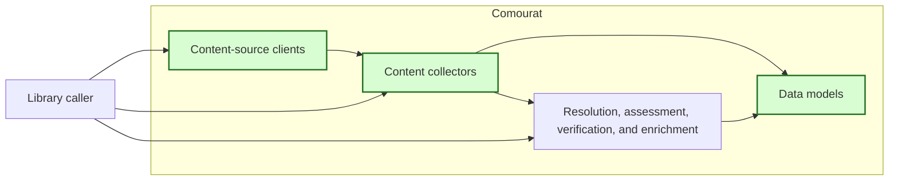
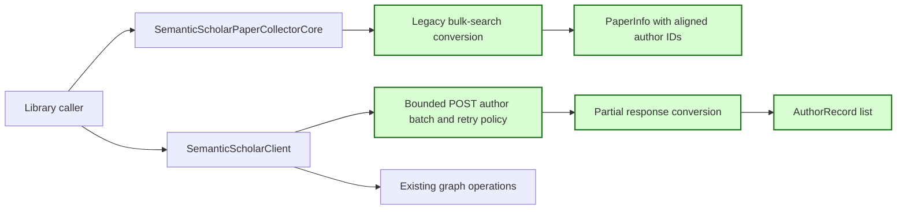

## Semantic Scholar author IDs and affiliations

### 1. Requirement analysis

This spec implements GitHub issue #24.

**R1 — Author IDs on bulk-search results.** Extend `PaperInfo` with an optional `author_ids` field. During legacy bulk-search conversion, retain each returned Semantic Scholar `authorId` at the same index as its author name in `authors`. Use `None` for an author without an ID. Keep all author names and all other available IDs. Existing `PaperInfo` callers that do not supply the new field must remain compatible. Do not change the separate publication-window `PaperCandidate` conversion.

**R2 — Public author retrieval.** Add `SemanticScholarClient.get_authors(author_ids)`. Accept a list of author IDs and return a list of neutral `AuthorRecord` Pydantic models. Each record must contain the returned `author_id`, `name`, and `affiliations` list. Use `POST <api_url>/author/batch` with query `fields=name,affiliations` and JSON body `{"ids": [...]}`. Return an empty list for empty input without an HTTP request. Split larger inputs into ordered chunks of at most the provider limit of 1000 IDs. Keep that limit in a named constant with a short comment.

**R3 — Explicit transport configuration and failure behavior.** Use the existing `SemanticScholarClient` constructor for the API URL, optional API key, optional proxy, injected HTTP session, request timeout, regular delay, maximum status retries, exponential backoff, and jitter. Do not read environment variables or application configuration. Do not import Mourat. Retry HTTP 429 and HTTP 5xx responses up to `max_retries` after the first attempt. Use a valid `Retry-After` value when supplied; otherwise use exponential backoff plus jitter. Apply the regular delay after each successful request. Raise a non-retryable HTTP status error at once. Raise the last HTTP status error after retry exhaustion. Let transport exceptions reach the caller. Do not return a fallback affiliation value or catch a terminal failure as a successful empty result.

**R4 — Partial response conversion.** The author-batch response is a list. Skip `null` entries and entries without an author ID. An omitted input ID needs no placeholder record. Preserve every valid returned record even when another entry is absent or null. Convert a missing or null affiliation field to an empty list. Preserve an empty affiliation list. Convert a missing or null name to an empty string. Do not discard a record only because its name or affiliation data is absent. Preserve response and chunk order. Do not add pipeline source selection or an application-specific `unknown` sentinel.

**R5 — Compatibility, documentation, and offline tests.** Preserve existing client and collector calls, request contracts, and result fields. Document author-ID retention and author retrieval. Update the author-affiliation terminology to include source author endpoints. Test with mocked HTTP responses, controlled delays, and dummy values only. No test requires live network access or credentials.

Expected behavior variants:

- **B1 — Complete author data.** Bulk-search results retain aligned names and IDs. Author retrieval returns IDs, names, and affiliations.
- **B2 — Partial author data.** Missing IDs use `None` on paper results. Missing author records and null entries produce no record. Missing names and affiliations do not remove a record that has an author ID.
- **B3 — Empty and chunked input.** Empty input causes no request. Input above the provider limit causes ordered bounded requests.
- **B4 — Request outcomes.** Transient statuses can be followed by success. Retry exhaustion, non-retryable statuses, and transport failures remain explicit.
- **B5 — Existing operation.** Existing model construction, legacy bulk search, and other graph operations keep their public contracts.

### 2. Tests

- **T1 — Bulk-search author-ID retention.** Covers R1, R5, B1, B2, and B5. Convert legacy bulk-search authors with complete, missing, and null IDs. Assert index-aligned `author_ids`, unchanged names, and the default for existing direct `PaperInfo` construction.
- **T2 — Author request and complete conversion.** Covers R2, R3, R5, and B1. Mock a successful POST. Assert the endpoint, query, JSON body, API-key header, timeout, and neutral records. Verify model serialization.
- **T3 — Partial and empty responses.** Covers R2, R4, R5, B1, and B2. Include an omitted input ID, a null entry, an entry without an ID, missing and null names, missing and null affiliations, and empty affiliations. Assert that all valid records survive in response order. Also cover an empty response list.
- **T4 — Empty input and chunking.** Covers R2, R5, and B3. Assert no HTTP request for empty input. Control the named batch-size constant and assert bounded ordered JSON bodies and combined output.
- **T5 — Retry and terminal failures.** Covers R3, R5, and B4. Control sleep and jitter. Assert `Retry-After`, exponential backoff, regular pacing, recovery, bounded status retries, immediate non-retryable failure, and propagated transport failure.
- **T6 — Regression and documentation checks.** Covers R1, R3, R5, and B5. Run existing client, collector, model, isolation, proxy, and complete offline tests. Run formatting, import-order, lint, type, build, and whitespace checks. Review the README, spec, and terminology updates.

### 3. Implementation plan

#### 3.1 Implementation repos

- `anton-pershin/comourat`: management repository and implementation repository.

#### 3.2 High-level design

The first diagram copies the constitution design and marks the changed clients, collectors, and models in green.

The second diagram shows the two changed data paths. Green marks author-ID retention, author retrieval, and the neutral records.

`PaperInfo.author_ids` remains optional for compatibility. When the legacy collector creates a paper, the list has the same length and order as `authors`. A missing ID is local to its author and does not affect another author.

`SemanticScholarClient` owns the new provider transport. A shared internal request helper preserves GET behavior and applies the same status-retry and pacing policy to POST. The public method splits input before transport and converts only records that contain an author ID. It returns source data without application fallback policy.

#### 3.3 Todo list

1. [x] Write the tests.
2. [x] Run the focused tests and ensure that they fail.
3. [x] Extend the neutral models, legacy conversion, and Semantic Scholar client.
4. [x] Run the focused tests and fix failures.
5. [x] Update the README and terminology document.
6. [x] Run the complete suite and all repository quality checks.
7. [x] Push the assigned branch and open a pull request linked to issue #24.

#### 3.4 Modification summary

| File | Action |
|------|--------|
| `.internal/specs/24-semantic-scholar-author-data-kiss-spec.md` | New: requirements, tests, and implementation plan. |
| `.internal/terminology.md` | Modified: define author IDs and include author endpoints in affiliation retrieval. |
| `comourat/models.py` | Modified: add aligned paper author IDs and neutral author records. |
| `comourat/collectors/semantic_scholar.py` | Modified: retain author IDs in legacy bulk-search conversion. |
| `comourat/clients/semantic_scholar.py` | Modified: add bounded author-batch POST retrieval and response conversion. |
| `tests/test_comourat_semantic_scholar.py` | Modified: cover legacy bulk-search author-ID retention. |
| `tests/test_comourat_semantic_scholar_authors.py` | New: mocked author-batch request, conversion, chunking, retry, and failure tests. |
| `tests/test_comourat_models.py` | Modified: cover the optional author-ID default and author-record serialization. |
| `README.md` | Modified: document author IDs and affiliation retrieval. |
