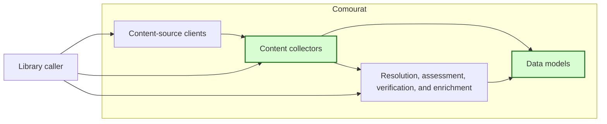
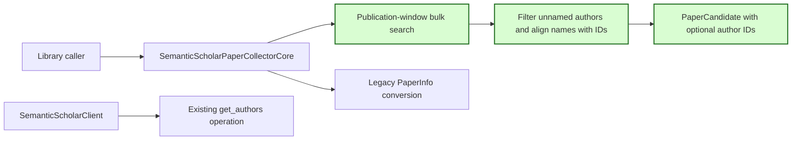

## Semantic Scholar publication-window author IDs

### 1. Requirement analysis

This spec implements GitHub issue #26.

**R1 — Optional author IDs on candidates.** Add `author_ids` to the neutral `PaperCandidate` model. Use the type `list[str | None] | None` and the default `None`. Existing direct construction without `author_ids` must remain valid. Keep the field independent of application-specific context and processing results.

**R2 — Aligned publication-window conversion.** Populate `PaperCandidate.author_ids` during publication-window bulk-search conversion. Retain each supplied Semantic Scholar `authorId` at the same index as its author name in `PaperCandidate.authors`. Use `None` for a missing or null ID. A missing ID for one author must not remove or shift another author's name or ID. When conversion excludes an author without a name, exclude that author's ID at the same time. Use the author data already present in the bulk-search response.

**R3 — Existing contracts and library boundary.** Keep `PaperInfo.author_ids`, legacy conversion, and `SemanticScholarClient.get_authors` unchanged. Do not add another paper request, a transport, an application-specific fallback value, or a Mourat dependency. Preserve all other candidate fields and existing collection behavior.

**R4 — Offline verification and documentation.** Add mocked publication-window tests for complete, missing, and null author IDs. Verify names, aligned IDs, all other candidate fields, and the default for direct `PaperCandidate` construction. Run the complete offline suite and configured quality checks. Update the README and terminology to distinguish author-ID retention on legacy `PaperInfo` results from retention on publication-window `PaperCandidate` results.

Expected behavior variants:

- **B1 — Complete author IDs.** Conversion retains every author name and ID in source order.
- **B2 — Partial author IDs.** Missing and null IDs become `None` without changing the positions of other names and IDs.
- **B3 — Excluded unnamed author.** Conversion excludes the name and ID together, so the remaining lists stay aligned.
- **B4 — Existing operation.** Direct candidate construction, legacy conversion, author retrieval, and other candidate fields keep their existing contracts.

### 2. Tests

- **T1 — Complete IDs and candidate fields.** Covers R1, R2, R3, R4, B1, and B4. Convert a publication-window response with complete author IDs. Assert the names, aligned IDs, and every other candidate field. Confirm that collection uses the existing single bulk-search request.
- **T2 — Partial IDs and unnamed-author exclusion.** Covers R2, R3, R4, B2, and B3. Convert authors with complete, missing, and null IDs and an unnamed author with an ID. Assert unchanged retained names and index-aligned IDs.
- **T3 — Direct model compatibility.** Covers R1, R4, and B4. Construct `PaperCandidate` without `author_ids`, assert the `None` default, and verify model serialization with retained IDs.
- **T4 — Regression and documentation checks.** Covers R3, R4, and B4. Run existing legacy conversion, author retrieval, model, collector, isolation, and complete offline tests. Run formatting, import-order, lint, type, build, and whitespace checks. Review the README, spec, and terminology updates.

### 3. Implementation plan

#### 3.1 Implementation repos

- `anton-pershin/comourat`: management repository and implementation repository.

#### 3.2 High-level design

The first diagram copies the constitution design and marks the changed collectors and models in green.

The second diagram shows the changed publication-window data path. Green marks candidate author-ID retention. The legacy and author-retrieval paths stay unchanged.

`PaperCandidate.author_ids` remains optional for compatibility. The publication-window converter first retains authors with names. It then maps names and IDs over the same retained list. This local change prevents index shifts and needs no additional source request.

#### 3.3 Todo list

1. [x] Write the tests.
2. [x] Run the focused tests and ensure that they fail.
3. [x] Extend `PaperCandidate` and publication-window conversion.
4. [x] Run the focused tests and fix failures.
5. [x] Update the README and terminology document.
6. [x] Run the complete suite and all repository quality checks.
7. [x] Push the assigned branch and open a pull request linked to issue #26.

#### 3.4 Modification summary

| File | Action |
|------|--------|
| `.internal/specs/26-semantic-scholar-candidate-author-ids-kiss-spec.md` | New: requirements, tests, and implementation plan. |
| `.internal/terminology.md` | Modified: distinguish author-ID retention on legacy and publication-window results. |
| `comourat/models.py` | Modified: add optional aligned author IDs to paper candidates. |
| `comourat/collectors/semantic_scholar.py` | Modified: retain aligned author IDs in publication-window conversion. |
| `tests/test_comourat_semantic_scholar.py` | Modified: cover complete and partial publication-window author IDs. |
| `tests/test_comourat_models.py` | Modified: cover the candidate author-ID default and serialization. |
| `README.md` | Modified: document author-ID retention on publication-window candidates. |
