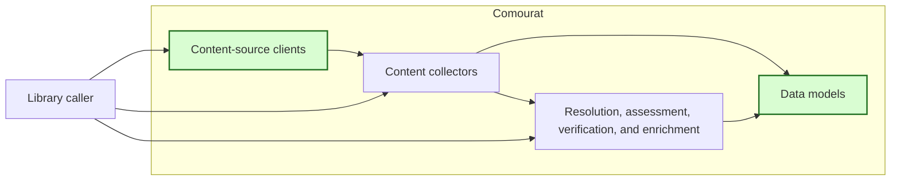
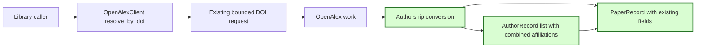

## OpenAlex paper author affiliations

### 1. Requirement analysis

This spec implements GitHub issue #28.

**R1 — Neutral author records on papers.** Add `author_records` to `PaperRecord` as a list of neutral `AuthorRecord` models. Use an empty list as the default so existing direct construction remains valid. Let `AuthorRecord.author_id` accept `None` so an author without a source ID keeps the name and affiliations. Existing `AuthorRecord` construction with an ID remains valid.

**R2 — OpenAlex authorship conversion.** During OpenAlex work conversion, create an author record for each authorship whose display name is retained in `PaperRecord.authors`. Keep the same author order in both lists. Copy the display name and the OpenAlex `author.id` when it is a non-empty string. Use `None` for a missing, null, empty, or malformed ID. Combine non-empty `institutions[].display_name` values followed by non-empty `raw_affiliation_strings` values in `AuthorRecord.affiliations`. Keep their source order and remove exact duplicates across and within both sources. Do not merge different strings or change their letter case.

**R3 — Partial data and existing paper behavior.** Ignore a missing, null, empty, or malformed affiliation container or entry only for its author. Keep usable affiliations for other authors. A missing author ID must not remove the author name or affiliations. An author without usable affiliation data must have an empty affiliation list. Preserve the existing `PaperRecord.authors` filtering and all identity, title, abstract, publication-date, citation-count, and raw-influence conversion.

**R4 — Existing request and failure contracts.** Use the existing `authorships` select field and the existing OpenAlex request path, timeout, pacing, and bounded retries. Do not add a second transport or an unbounded request loop. Return `None` for an unresolved DOI as before. Propagate terminal HTTP and transport failures as before.

**R5 — Documentation and offline verification.** Document the neutral author records and combined affiliations. Update the existing author-record and author-affiliation definitions without adding application-specific terms. Use mocked OpenAlex responses and dummy values only. Run the complete Comourat test suite and quality checks. Supply the pull-request reference for Mourat integration.

Expected behavior variants:

- **B1 — Institution names.** Conversion retains non-empty institution display names in source order.
- **B2 — Raw affiliation strings.** Conversion retains non-empty raw strings in source order.
- **B3 — Combined affiliation data.** Institution names come before raw strings, and only exact duplicates are removed.
- **B4 — Partial author data.** Missing IDs and malformed or empty affiliation data for one author do not affect other authors.
- **B5 — No usable affiliation data.** Retained authors keep their names and available IDs with empty affiliation lists.
- **B6 — Request outcomes.** DOI resolution uses the existing request contract. An unresolved DOI returns `None`, and terminal failures remain explicit.
- **B7 — Existing operation.** Existing model construction and all other paper fields keep their public contracts.

### 2. Tests

- **T1 — DOI resolution and complete neutral conversion.** Covers R1, R2, R3, R4, R5, B1, and B7. Mock a successful DOI lookup with complete authorships and paper metadata. Assert the request filter, select fields, page limit, timeout, paper identity, title, authors, author records, abstract, publication date, citation count, and raw influence.
- **T2 — Affiliation source variants.** Covers R2, R3, R5, B1, B2, and B3. Parameterize institution-only, raw-only, and combined responses. Include empty values, malformed entries, repeated values, and a raw string that duplicates an institution name. Assert source order and exact duplicate removal.
- **T3 — Independent partial author data.** Covers R1, R2, R3, R5, and B4. Mix complete authors with authors that have missing, null, empty, or malformed IDs and affiliation containers. Assert that each usable name, ID, and affiliation survives without changing other author records.
- **T4 — No usable affiliations and model compatibility.** Covers R1, R3, R5, B5, and B7. Convert named authorships without usable affiliation data and assert empty affiliation lists. Construct existing paper and author models without the new values and verify defaults and serialization.
- **T5 — Unresolved DOI and bounded terminal failure.** Covers R4, R5, and B6. Assert `None` for no results and for HTTP 404. Assert the existing request-attempt bound and propagated terminal HTTP and transport errors.
- **T6 — Regression and documentation checks.** Covers R3, R4, R5, and B7. Run existing client, model, resolution, collector, isolation, proxy, and complete offline tests. Run formatting, import-order, lint, type, build, and whitespace checks. Review the README, spec, and terminology updates.

### 3. Implementation plan

#### 3.1 Implementation repos

- `anton-pershin/comourat`: management repository and implementation repository.

#### 3.2 High-level design

The first diagram copies the constitution design and marks the changed client and models in green.

The second diagram shows the changed OpenAlex conversion path. Green marks neutral author-record creation and affiliation conversion. The existing transport stays unchanged.

`PaperRecord.author_records` reuses the existing neutral `AuthorRecord` model. The OpenAlex converter processes each authorship independently. It retains the existing author-name list and adds an aligned record list. A small conversion helper combines the two affiliation sources and removes exact duplicates without changing the request layer.

#### 3.3 Todo list

1. [x] Write the tests.
2. [x] Run the focused tests and ensure that they fail.
3. [x] Extend the neutral models and OpenAlex conversion.
4. [x] Run the focused tests and fix failures.
5. [x] Update the README and terminology document.
6. [x] Run the complete suite and all repository quality checks.
7. [x] Push the assigned branch and open a pull request linked to issue #28.

#### 3.4 Modification summary

| File | Action |
|------|--------|
| `.internal/specs/28-openalex-paper-author-affiliations-kiss-spec.md` | New: requirements, tests, and implementation plan. |
| `.internal/terminology.md` | Modified: include optional author IDs and paper-level affiliation metadata. |
| `comourat/models.py` | Modified: add paper author records and permit a missing author ID. |
| `comourat/clients/openalex.py` | Modified: convert author IDs, institution names, and raw affiliation strings. |
| `tests/test_comourat_openalex_affiliations.py` | New: cover DOI conversion, partial data, duplicate removal, and failure compatibility. |
| `tests/test_comourat_models.py` | Modified: cover neutral model defaults and serialization. |
| `README.md` | Modified: document OpenAlex paper author affiliations. |
