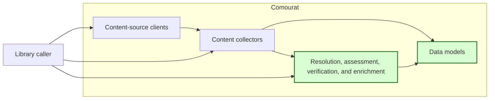
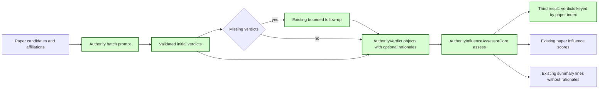

## Authority verdict rationales

### 1. Requirement analysis

This spec implements approved GitHub issue #30.

**R1 — Optional verdict rationale.** Add `rationale` to `AuthorityVerdict` as an optional string with a default of `None`. It contains a concise model-produced explanation of the authority score based on the supplied authors and affiliations or institutions. Existing score validation remains unchanged. A validated verdict without a rationale retains its score and remains a successful assessment.

**R2 — Rationale prompt.** Update the authority-assessment batch prompt to request a rationale with every verdict. Require one or two concise sentences that explain the score from the supplied authors and affiliations or institutions. Keep the existing paper IDs, score range, batching, and bounded request behavior.

**R3 — Verdict retention.** Retain each validated `AuthorityVerdict`, including its score and optional rationale, through normal batch processing and the missing-verdict follow-up flow. Continue to discard verdicts with IDs outside the requested batch. Do not reduce validated verdicts to scores before follow-up processing is complete.

**R4 — Structured assessment output.** Extend `AuthorityInfluenceAssessorCore.assess()` to return `(papers, summary_lines, verdicts_by_id)`. The third value maps each existing `paper_<index>` ID to its validated `AuthorityVerdict`. Include every successfully scored verdict, including a score of 0 and a verdict without a rationale. Do not include an unassessable paper that receives the fail-open score of 0 without a validated verdict. Preserve the existing `PaperCandidateCollection` result and in-place score assignment.

**R5 — Unchanged summary lines.** Keep rationale text out of `summary_lines`. Preserve the existing summary-line content and formatting. Monitoring presentation remains the caller's responsibility.

**R6 — Documentation and verification.** Document the optional rationale and the three-value `assess()` return contract for library callers. Do not add monitoring handlers, application-specific formatting, Mourat dependencies, or other application dependencies. Use mocked model responses and controlled inputs. Run the complete Comourat test suite and quality checks.

Expected behavior variants:

- **B1 — Verdict with rationale.** A valid verdict retains its score and rationale through assessment.
- **B2 — Verdict without rationale.** An omitted or null rationale is valid, retains its score, and appears in the structured result with `rationale is None`.
- **B3 — Valid zero score.** A validated verdict with score 0 appears in the structured result and is not treated as an unassessable paper.
- **B4 — Normal and follow-up paths.** Rationales survive both an initial batch response and a successful follow-up response for a missing verdict.
- **B5 — Missing or failed verdict.** A missing verdict or failed request keeps the existing fail-open behavior and produces no entry in the structured result unless a validated verdict later arrives.
- **B6 — Existing presentation.** Summary lines keep their previous text and contain no rationale.

### 2. Tests

- **T1 — Optional model field.** Covers R1, R6, B1, and B2. Construct verdicts with a rationale, without a rationale, and with a null rationale. Assert score retention, the default, and serialization. Confirm existing score bounds remain enforced.
- **T2 — Batch prompt requirement.** Covers R2 and R6. Inspect the generated authority prompt and assert that it requests a rationale for each verdict, limits it to one or two concise sentences, and grounds it in the supplied authors and affiliations or institutions.
- **T3 — Structured normal-batch output and unchanged summaries.** Covers R1, R3, R4, R5, R6, B1, B2, and B6. Assess papers whose validated verdicts include rationales and omitted rationales. Assert the three return values, exact `paper_<index>` keys, retained verdict objects, existing scores, and summary lines without rationale text.
- **T4 — Follow-up retention.** Covers R3, R4, R6, and B4. Return one verdict in the initial response and the missing paper's verdict with a rationale in the follow-up response. Assert both validated verdicts and rationales in the structured result and the existing two-call behavior.
- **T5 — Valid zero and fail-open outcomes.** Covers R1, R3, R4, R5, R6, B3, B5, and B6. Distinguish a validated score-0 verdict from an unassessable paper with a fail-open score of 0. Assert that only the validated verdict appears in the mapping and that existing summary lines remain unchanged.
- **T6 — Regression and documentation checks.** Covers R1 through R6 and all behavior variants. Run existing authority, influence, isolation, and complete offline tests. Run formatting, import-order, lint, type, build, and whitespace checks. Review the README, method documentation, and spec against the implementation.

### 3. Implementation plan

#### 3.1 Implementation repos

- `anton-pershin/comourat`: management repository and implementation repository.

#### 3.2 High-level design

The first diagram copies the constitution design and marks the changed processing component and authority verdict model in green.

The second diagram shows the changed authority-assessment data flow. Green marks rationale retention and the new structured result. The existing summary path remains unchanged.

`AuthorityVerdict` remains the single validated record for a paper. Internal batch processing retains these records instead of extracting only scores. `assess()` merges normal and follow-up verdicts by the existing paper ID, uses their scores for the current paper and summary behavior, and returns the same records as a third value. Missing or failed assessments do not create verdict records.

#### 3.3 Todo list

1. [x] Write the tests.
2. [x] Run the focused tests and ensure that they fail.
3. [x] Extend the verdict model, prompt, batch retention, and assessment result.
4. [x] Run the focused tests and fix failures.
5. [x] Document the verdict rationale and extended return contract.
6. [x] Run the complete suite and all repository quality checks.
7. [x] Push the assigned branch and open a draft pull request linked to issue #30.

#### 3.4 Modification summary

| File | Action |
|------|--------|
| `.internal/specs/30-authority-verdict-rationales-kiss-spec.md` | New: requirements, tests, and implementation plan. |
| `comourat/influence/authority.py` | Modified: optional rationale, prompt requirement, verdict retention, and structured assessment result. |
| `tests/test_comourat_influence.py` | Modified: cover validation, prompt text, normal and follow-up retention, zero scores, unchanged summaries, and failures. |
| `README.md` | Modified: document the optional rationale and three-value assessment result. |
