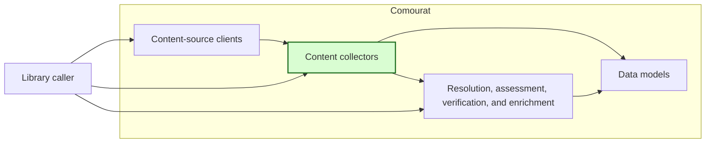
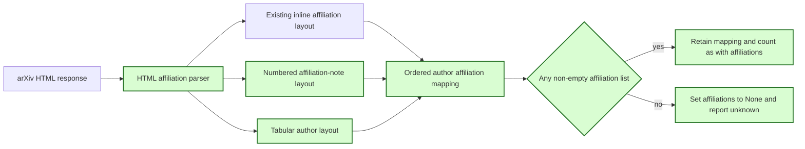

## arXiv HTML affiliation layouts

### 1. Requirement analysis

This spec implements approved GitHub issue #32.

**R1 — Existing affiliation extraction contract.** Keep `ArxivHtmlAffiliationFetcherCore.fetch_affiliations` and its author-to-affiliations mapping interface unchanged. Preserve the existing inline `ltx_personname` and `ltx_role_affiliation` layout, affiliation order, exact duplicate removal, request pacing, publication-date retrieval, and fetch-failure behavior. Extraction remains deterministic and does not use an LLM.

**R2 — Numbered affiliation notes.** Support arXiv HTML renderings where bold author names have numeric affiliation-reference superscripts and numbered affiliations occur in `ltx_role_footnotetext` notes. Map each author to every referenced affiliation in source order. Exclude author superscripts, note labels, and unrelated correspondence text from names and affiliations. For the controlled markup from arXiv `2611.27092`, supply the University of California, Irvine affiliation to Faraz Tahmasebi, Hyoukjun Kwon, and Sitao Huang, and the NVIDIA affiliation to Michael Pellauer. Preserve affiliation detail present in the source after the reference number.

**R3 — Tabular author blocks.** Support `ltx_tabular` markup inside `ltx_personname` where name rows and affiliation rows alternate in matching columns. Detect names through `ltx_font_bold`, associate each following affiliation cell by column, and skip typewriter email rows. Exclude affiliation-reference superscripts and unrelated notes. For the controlled markup from arXiv `2611.27500`, return `Qualcomm AI Research` for Anna Kuzina, Mart van Baalen, and Paul N. Whatmough, and `NVIDIA` for Babak Ehteshami Bejnordi.

**R4 — Unknown affiliations.** Count a fetched paper as having affiliations only when at least one extracted author has a non-empty affiliation list. If every list is empty, or no author mapping is extracted, set `paper.affiliations` to `None`, include the paper in the unknown-affiliations summary, and do not increment the with-affiliations count. If at least one affiliation is available, retain the extracted mapping, including empty lists for authors without an affiliation.

**R5 — Offline verification and scope.** Use controlled HTML fixtures based on the two approved examples, the known-good inline examples from the PR review, and mocked HTTP responses. Do not require live network access in automated tests. Run the complete Comourat test suite and repository quality checks. Do not change neutral data models, caller configuration, other collectors, or influence scoring.

Expected behavior variants:

- **B1 — Inline affiliation spans.** Existing author and affiliation spans retain their current mapping, order, and duplicate handling.
- **B2 — Shared and distinct numbered references.** Authors that share a reference receive the same affiliation, while an author with another reference receives that affiliation instead. Correspondence text is not part of either affiliation.
- **B3 — Multirow author table.** Names and affiliations align by column across more than one name row. Email addresses and superscript note marks do not become affiliations.
- **B4 — Empty extraction.** A mapping with only empty lists is unknown rather than a successful affiliation result.
- **B5 — Partial extraction.** A mapping with at least one non-empty list remains usable, including any empty lists for other authors.
- **B6 — Existing fetch behavior.** HTTP failures, publication dates, request pacing, and the returned collection and summary structure retain their current contracts.

### 2. Tests

Add focused tests to `tests/test_comourat_arxiv_html_affiliations.py`. Reuse or extend the existing collector test only where necessary.

- **T1 — Inline layout regression.** Covers R1, R5, B1, and B6. Extract authors with one or more inline affiliation spans and an exact duplicate. Assert the existing mapping and affiliation order. Add controlled author-block fixtures based on known-good arXiv `2611.27741`, `2611.27712`, and `2611.27100`; include author-note wrappers, email spans, frontmatter notes, and single and multiple affiliations. Assert their exact existing mappings. Keep the existing fetcher test for its publication date and HTTP interaction.
- **T2 — Numbered affiliation notes.** Covers R2, R4, R5, and B2. Use controlled markup from `2611.27092`, including four bold author names, numeric references, one footnote containing two affiliations, and trailing correspondence text. Assert all four exact author mappings, shared affiliations, preserved source affiliation detail, and exclusion of labels and correspondence.
- **T3 — Tabular author block.** Covers R3, R4, R5, and B3. Use controlled markup from `2611.27500`, including two name rows, two affiliation rows, email rows, a superscript note mark, and an unrelated footnote. Assert the four exact author-to-affiliation mappings and absence of emails, note marks, and unrelated note text.
- **T4 — Empty and partial fetch outcomes.** Covers R1, R4, R5, B4, B5, and B6. Mock successful Atom and HTML responses. For an all-empty mapping, assert `affiliations is None`, an unknown-paper summary entry, and a zero with-affiliations count. For a partial mapping, assert retention of non-empty and empty author lists and a with-affiliations count of one.
- **T5 — Complete regression and quality checks.** Covers R1 through R5 and all behavior variants. Run focused tests, existing collector tests, the complete offline test suite, formatting, import-order, lint, type, build, and whitespace checks. Review the module documentation and spec against the implementation.

### 3. Implementation plan

#### 3.1 Implementation repos

- `anton-pershin/comourat`: management repository and implementation repository.

#### 3.2 High-level design

The first diagram copies the constitution design and marks the changed collector in green. The data models and public interfaces do not change.

The second diagram shows the changed affiliation parser. Green marks layout-specific extraction and the all-empty result check. The existing HTTP and Atom API paths stay unchanged.

The existing BeautifulSoup dependency parses the HTML instead of adding more nested-markup regular expressions. Small helpers handle inline affiliations, numbered notes, and tabular author rows. A shared merge helper retains source order and removes exact duplicate affiliations. The fetcher makes the unknown decision from the extracted values without changing its public interface.

#### 3.3 Todo list

1. [x] Write the specification and focused tests.
2. [x] Run the focused tests and ensure that the new cases fail.
3. [x] Implement the three layout parsers and all-empty handling.
4. [x] Run the focused tests and fix failures.
5. [x] Update the module documentation and specification evidence.
6. [x] Run the complete suite and all repository quality checks.
7. [x] Push the assigned branch and open a draft pull request linked to issue #32.

#### 3.4 Modification summary

| File | Action |
|------|--------|
| `.internal/specs/32-arxiv-html-affiliation-layouts-kiss-spec.md` | New: requirements, tests, and implementation plan. |
| `comourat/collectors/arxiv_html_affiliations.py` | Modified: parse numbered-note and tabular layouts, preserve inline extraction, and handle all-empty mappings as unknown. |
| `tests/test_comourat_arxiv_html_affiliations.py` | New: controlled inline, numbered-note, tabular, empty, and partial extraction tests. |
